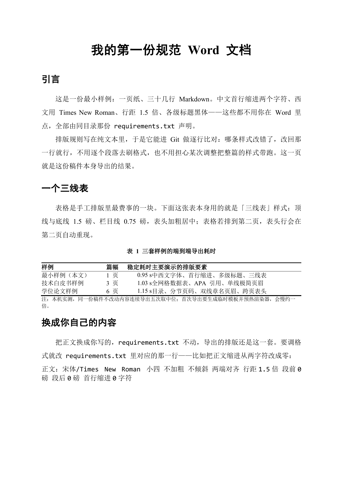
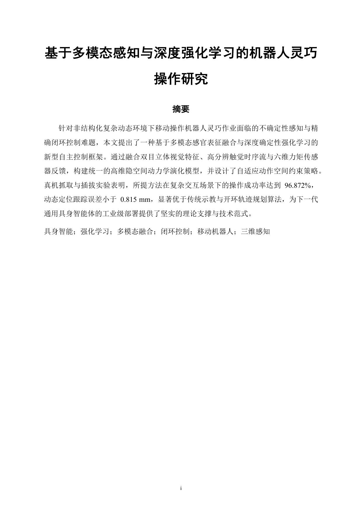
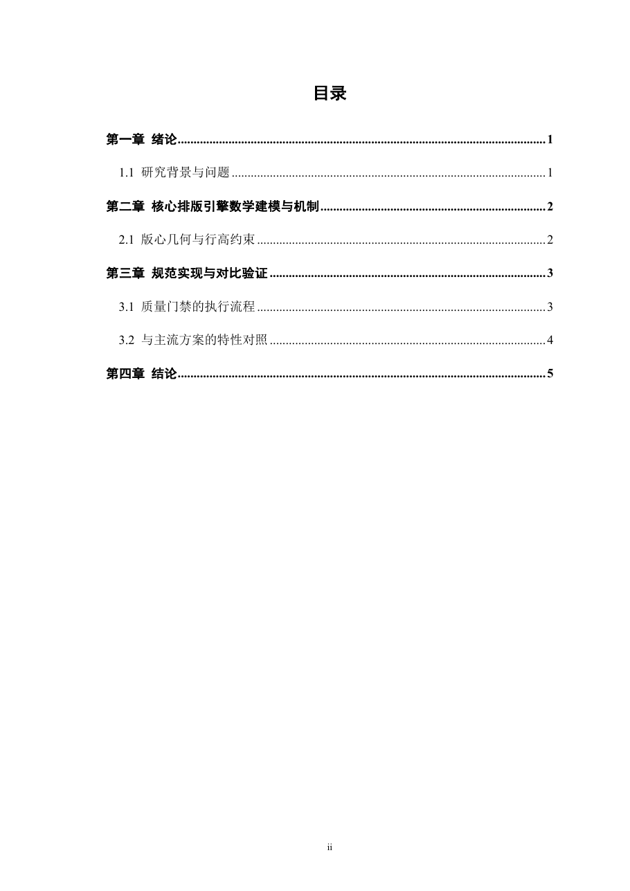
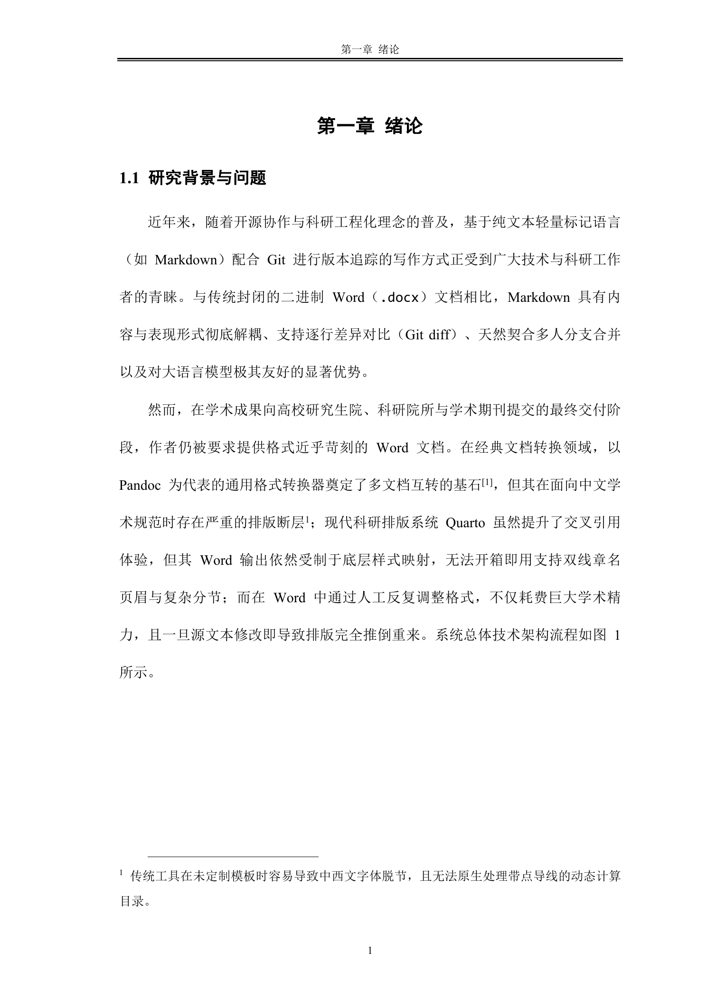
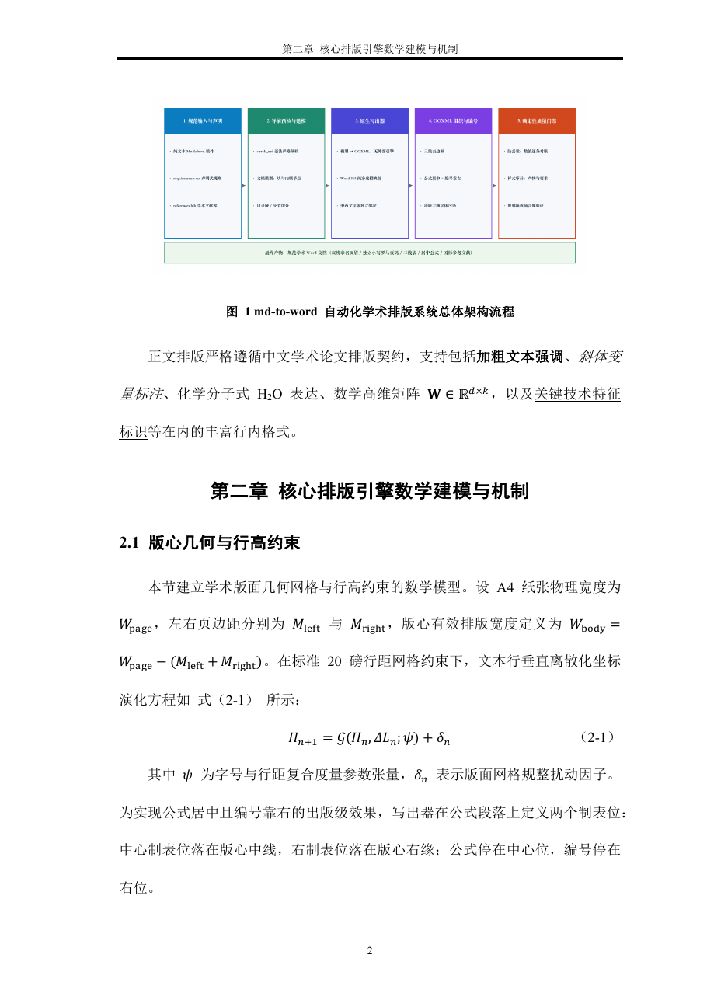
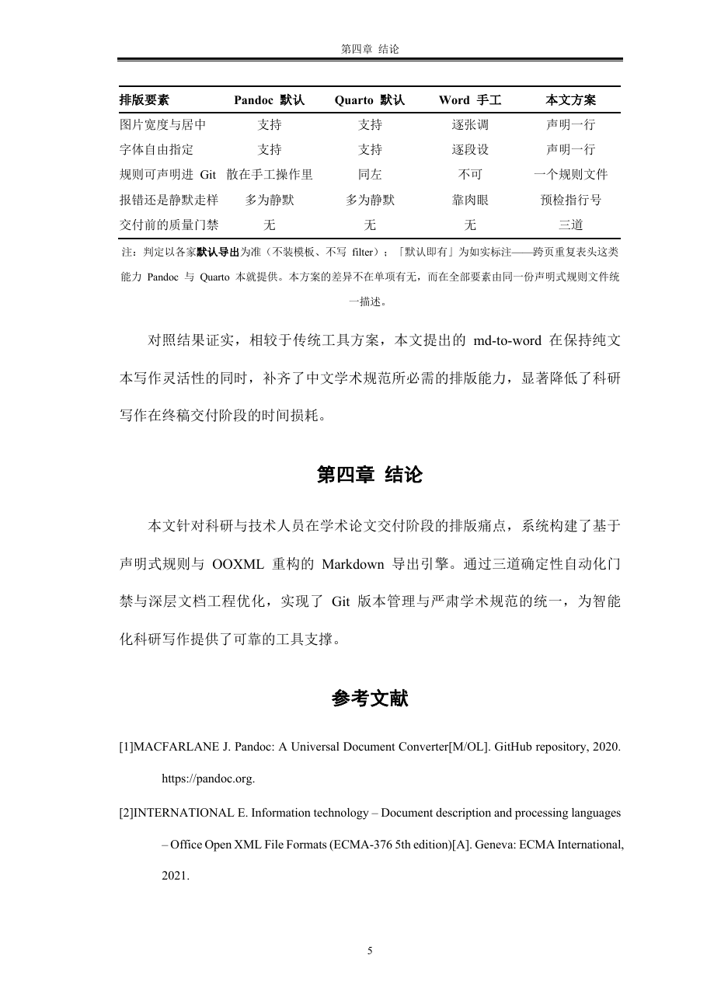
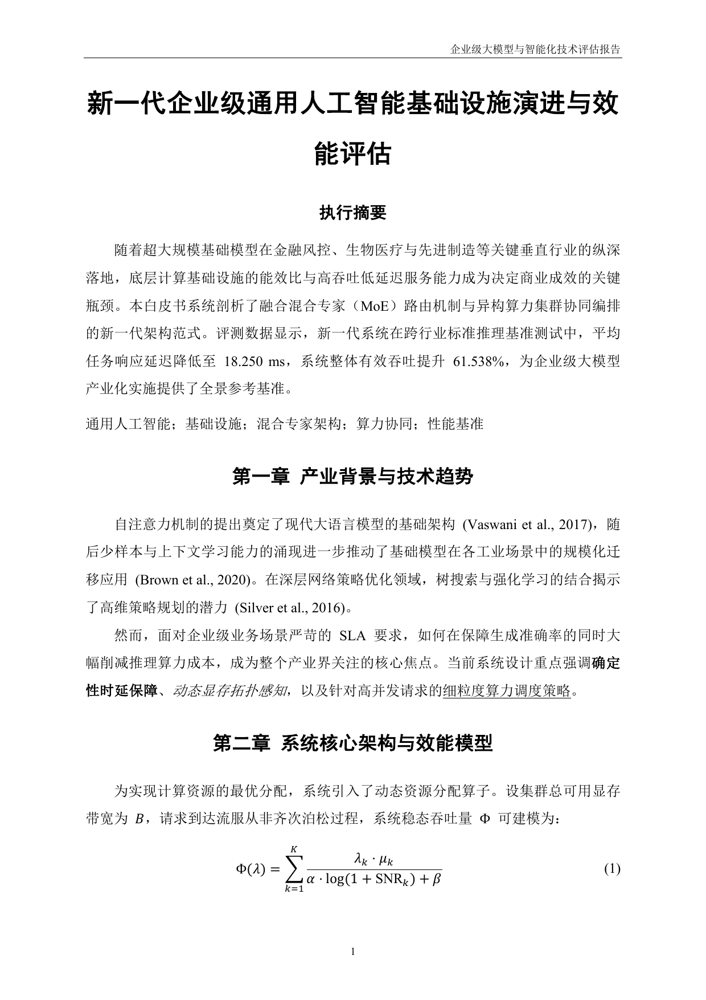
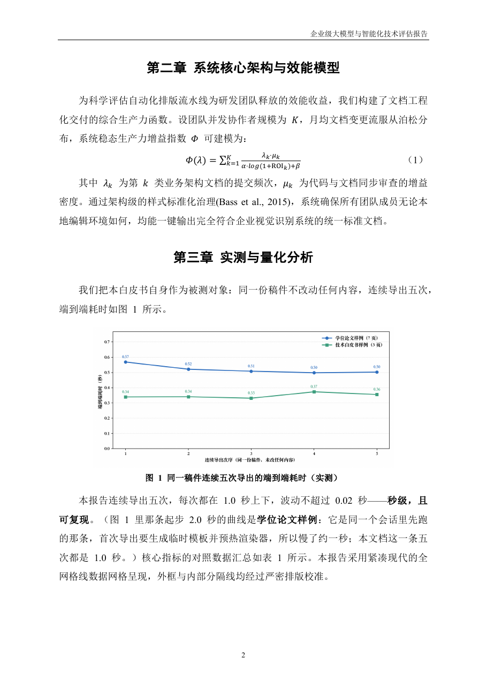
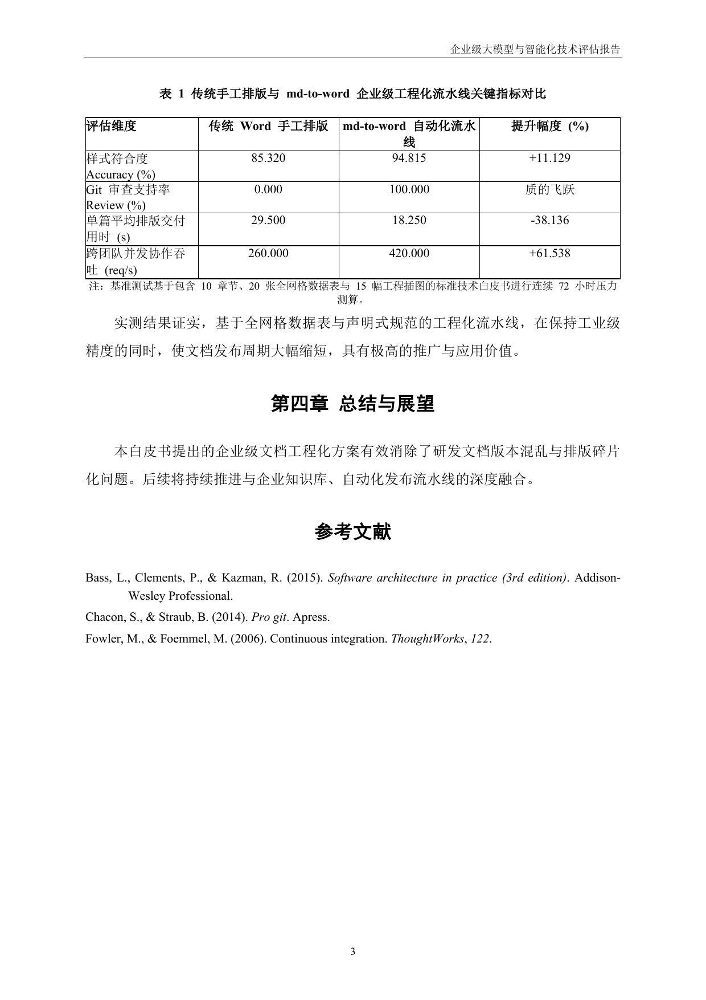

# md-to-word：专为 AI Agent 与 Markdown 打造的规范 Word 排版技能

[](https://github.com/1c7/chinese-independent-developer/blob/master/.github/pages/README-Programmer-Edition.md)
[-0969da?logo=github&logoColor=white)](https://github.com/Imbad0202/academic-research-skills/blob/main/THIRD_PARTY.md#listed-projects)
[](https://github.com/ls-open/md-to-word/releases)
[](LICENSE)
[](https://www.python.org/)

[English](README_EN.md) | [简体中文](README.md)

> **用纯文本与 Git 挥洒思想，让 AI 全自动交付规范的 Word（`.docx`）文档。**  
> 一键直出符合**中国高校硕博学位论文、中文核心学术期刊、企业级技术白皮书与规范公文**排版标准的 Word 文件。

---

## 💡 为什么坚持 Markdown + md-to-word？

在长篇学术论文、专业技术报告与商业白皮书的撰写中，许多团队都经历过 Word 带来的协作阵痛：

* **Word（`.docx`）是封闭的二进制黑盒**：Git 无法对其进行行级差异对比（diff），改动全凭肉眼；多人协作时分支合并（merge）极易损坏文件，团队只能依靠“`论文_终稿_v2_定稿_真的不改了.docx`”痛苦传递。
* **排版耗费大量非生产性时间**：在 Word 中反复刷样式、手动断开分节符、调整三线表边框、狂按空格硬凑公式对齐；一旦源文字稍作修改，排版往往前功尽弃。

**md-to-word 提供的现代化工作流**：
1. **内容与排版彻底解耦**：作者在纯文本 Markdown 中专注逻辑与思考，享受 Git 版本分支、代码审查（PR）与持续集成的全部工程红利；
2. **AI Agent 原生友好**：大语言模型天然精通 Markdown，配合本技能可直接全流程闭环完成规范排版；
3. **确定性交付**：通过纯净 Word 365 底模与中文声明式规则，全自动输出符合严格审查标准的规范 Word。

---

## ⚡ 30 秒看懂：你写的 vs 你得到的

排版规则写在 `requirements.txt` 里——**一行一条，进 Git 能 diff**，不用在 Word 里点。

**你写的**（[`demo/00_quickstart/hello.md`](demo/00_quickstart/hello.md)，节选）：

```markdown
---
title: "我的第一份规范 Word 文档"
crossref:
  tbl-prefix: "表"
---

# 引言

这是一份最小样例：一页纸、二十六行 Markdown。中文首行缩进两个字符、西文用
Times New Roman、行距 1.5 倍、各级标题黑体——这些都不用你在 Word 里点。

# 一个三线表

| 样例 | 篇幅 | 稳定耗时 | 主要演示的排版要素 |
|:------|:--|:---|:--------------|
| 最小样例（本文） | 1 页 | 0.95 s | 中西文字体、首行缩进、多级标题、三线表 |
| 技术白皮书样例 | 3 页 | 1.03 s | 全网格数据表、APA 引用、单线极简页眉 |
| 学位论文样例 | 8 页 | 1.15 s | 目录、分节页码、双线章名页眉、跨页表头 |

…（表格上方的表题包裹块、表注与正文段落见源文件）
```

**你声明的**（[`demo/00_quickstart/requirements.txt`](demo/00_quickstart/requirements.txt)，全部 16 行）：

```text
纸张：A4
页边距：上2.54cm 下2.54cm 左2.54cm 右2.54cm
西文字体：Times New Roman
校对语言：zh-CN

文档标题：黑体/Times New Roman 二号 加粗 不倾斜 居中 行距1.5倍 段前0磅 段后12磅 首行缩进0字符 无边框
一级标题：黑体/Times New Roman 三号 加粗 不倾斜 左对齐 行距1.5倍 段前12磅 段后6磅 首行缩进0字符 与下段同页
正文：宋体/Times New Roman 小四 不加粗 不倾斜 两端对齐 行距1.5倍 段前0磅 段后0磅 首行缩进2字符
首段：宋体/Times New Roman 小四 不加粗 不倾斜 两端对齐 行距1.5倍 段前0磅 段后0磅 首行缩进2字符
普通：宋体/Times New Roman 小四 不加粗 不倾斜 两端对齐 行距1.5倍 段前0磅 段后0磅 首行缩进2字符

紧凑：宋体/Times New Roman 五号 不加粗 不倾斜 居中 行距1.0倍 段前0磅 段后0磅 首行缩进0字符
表格：居中 三线表 线宽上1.5磅 线宽底1.5磅 线宽表头下0.75磅 单元格垂直居中
表头：宋体/Times New Roman 五号 加粗 不倾斜 居中 行距1.0倍 段前0磅 段后0磅 首行缩进0字符 跨页重复
表格题注：宋体/Times New Roman 五号 加粗 不倾斜 居中 行距1.5倍 段前6磅 段后6磅 首行缩进0字符 与下段同页
表注：宋体/Times New Roman 小五 不加粗 不倾斜 左对齐 行距1.0倍 段前0磅 段后6磅 首行缩进0字符
```

**你跑的**：

```bash
bash scripts/export.sh hello.md -r requirements.txt -o hello.docx
```

**你得到的**（约 1 秒）：

[](demo/00_quickstart/hello.docx)

中文首行缩进两个字符、西文 Times New Roman、三线表带表题表注——**没有一步是在 Word 里点的**。

---

## 📄 手上有现成的模板？（学校 / 期刊 / 单位发的 `.docx`）

不用对着模板一条条抄格式要求。把模板交给助手，让它跑这个脚本反推出一份 `requirements.txt` 草稿：

```bash
python3 scripts/read_reference_docx.py 学校模板.docx -o 论文_requirements.txt
```

读出来的是：页面尺寸、页边距、页眉页脚距边界、页码格式与起始、各样式的中西文字体与字号、加粗倾斜、对齐、行距（**分得清倍数 / 固定值 / 最小值**）、段前段后、缩进（**字符单位也读得到**）、段落下边框、表格边框与表头行、页眉页脚内容与域。**读不出来的项会列成待确认清单**，不会假装读到了。


## 🚀 装上它：三步，全交给你的 AI 助手

本项目是**面向 AI 智能体**调优的技能——你不用在终端敲任何命令，把源码交给助手，剩下的它代办。

1. **让助手自己装**：把下面这句话原样发给它。各家助手的技能目录位置不同、系统之间也不同，**交给它自己判断，你不用操心**：

   > 帮我安装这个技能：https://github.com/ls-open/md-to-word
   > 克隆到你的技能目录，装好后读一遍 SKILL.md，告诉我它能做什么、怎么触发。

2. **验证装好了**：让助手跑一遍仓库里最小的一份样例，看到 `✅ Word 文档导出成功` 就算装成了：

   ```bash
   cd demo/00_quickstart
   bash ../../scripts/export.sh hello.md -r requirements.txt -o hello.docx
   ```

3. **开始用它**：把你的 Markdown 发给助手，说清要什么格式：

   > 帮我把这份《智能系统设计.md》按某某大学研究生学位论文的格式要求导出为 Word。

   接下来它全包：识别版面与字体要求 → 生成合规底模 → 编译并净化 OOXML → 跑三道质量门禁 → 把 `.docx` 交给你。

> 💡 **命令行 / CI 也可直接用**：
> `bash scripts/export.sh 你的文档.md [-r 格式要求.txt] -o 输出文档.docx`
>
> 加 `--pdf` 还能顺带用本机 Word 渲染一份 PDF——**这是唯一能把目录页码、页眉章名这些「域」真正展开的方式**，用它核对成品最直接（**仅 macOS**，且本机装了 Word 并至少启动过一次；不可用时会自动跳过，不影响 `.docx`）。

---

## 📸 排版效果实测展示（本技能体系自举样例）

除上面那份最小样例外，仓库还内置**两套完整样例**，均基于 md-to-word 本身的设计原理与工程实践撰写，真正实现“以身说法”：

### 样例一：中文硕博学位论文 / 核心期刊（全要素学术排版）
> 前置独立小写罗马页码（`i, ii`）、Word 原生动态目录（收到二级）、双线动态章名页眉、**三线表跨页时自动重现表头**、公式按章编号（学位论文写法 `（2-1）`）且绝对居中靠右、GB/T 7714-2015 顺序编码文献；版式上另有**装订线 1cm**、**每页 22 行**与标题**字符间距 1 磅**。

📁 源码、格式规则与一键复现命令 → **[demo/01_chinese_thesis](demo/01_chinese_thesis/README.md)**

| 论文开篇与摘要（居中大标题/无页眉） | Word 动态目录（点线引导、小写罗马页码） | 动态章名页眉与架构流程图 |
| :---: | :---: | :---: |
|  |  |  |

|                 公式按章编号与质量门禁流程                  |            **表跨页后自动重现表头**与国标参考文献             |
| :--------------------------------------------: | :------------------------------------------: |
|  |  |

---

### 样例二：现代企业级技术白皮书 / 商业研究报告
> 扁平单节结构、开门见山执行摘要、单线现代极简页眉、全网格线数据表、APA 7th 作者-年份制引用。

📁 源码、格式规则与一键复现命令 → **[demo/02_modern_report](demo/02_modern_report/README.md)**

|                执行摘要与正文第一章                 |                  效能推导公式与耗时实测图                   |               全网格线数据表与 APA 参考文献                |
| :---------------------------------------: | :---------------------------------------------: | :--------------------------------------------: |
|  |  |  |

---

## 🔍 横向对比：同一个效果，各方要做什么

判定口径：各工具均取**默认导出**（不装模板、不写 filter）。⚠️ = 能做，但要手工改底模、逐段逐表设置或自己写 XML；✅ = 默认就有；❌ = 默认路径下没有。**最后一列是本技能的实际写法。**

| 排版要素 | 原生 Pandoc 默认导出 | Quarto 默认 Word 导出 | Word 手工排版 | 🌟 md-to-word：写这一行 |
|:---|:---:|:---:|:---:|:---|
| 数学公式居中 + 编号靠右 | ❌ 无编号（`{#eq-x}` 原样漏成正文文字） | ⚠️ 公式居中但编号紧跟在尾部 | ⚠️ 手设三列制表位 | `$$…$$ {#eq-x}` 自动居中靠右 |
| 双线动态章名页眉 | ❌ 须改底模并插域 | ❌ 须改底模并插域 | ⚠️ 逐节断开 + 插域 | `页眉内容：{样式标题:Heading 1}` |
| 前置小写罗马 / 正文阿拉伯分节 | ❌ | ❌ | ⚠️ 手工插分节符 | `` |
| 排版规则可声明、可进 Git 评审 | ❌ 散在 XML 与手工操作里 | ❌ | ❌ | 一个 `requirements.txt` 说清全部 |
| 出错时是报错还是静默走样 | ⚠️ 多为静默 | ⚠️ 多为静默 | ❌ 全靠肉眼 | 导前预检带行号指出 |
| 交付前的质量门禁 | ❌ | ❌ | ❌ | 三道：预检 / 防丢数 / 逐条对账 |

> **上表只列拉开差距的项。** 各家默认路径也能做到的（中文字体分离与首行缩进、三线表与线宽、跨页重复表头、参考文献自动排版），本技能同样支持，只是不构成差异，故未列入。
>
> **此外还有**：脚注（`[^1]`）、Word 原生动态目录 ``、奇偶页/首页不同的页眉页脚与 `{总页数}` 域、表格四种边框形态（三线表/全网格线/顶底线/无边框）、用现成 `.docx` 当底模（`-t`）、导出前剥掉稿件里的 HTML 注释（`--strip-comments`）。
>
> 这张表里 Pandoc 与 Quarto 的 ✅ 是**如实标注**的——比如跨页重复表头和 citeproc 参考文献，它们默认就有。本技能的价值不在「别人做不到」，而在**同一份 `requirements.txt` 把所有项一次性说清**：不用改底模、不用写 XML、不用逐段逐表点鼠标。

---

## 📚 常见疑问：什么是参考文献（.bib）？如何获取？

很多初次接触学术排版的用户不清楚 `.bib` 文件是什么：

* **什么是 `.bib`？**  
  `.bib`（BibTeX）是全球学术界通用的**纯文本结构化参考文献数据库**。每一条文献包含条目类别、作者、篇名、期刊、出版年份等字段。
* **如何获取？完全不需要手动敲代码，两大傻瓜获取方式**：
  1. **各大检索网站一键导出（知网 / 百度学术 / 谷歌学术）**：  
     在知网（CNKI）、百度学术或 Google Scholar 搜索到目标论文后，点击文献下方的“**引用**”按钮 → 选择“**导出 BibTeX**”，将弹出的文本复制保存为 `references.bib` 即可。
  2. **文献管理软件批量导出（Zotero / EndNote / Mendeley）**：  
     在 Zotero 或 EndNote 中选中所需文献，右键选择“**导出文献库**”，导出格式选择 **BibTeX**。
* **如何在正文中使用？**  
  在 Markdown 中只需写 `[@文献key]`（例如 `[@vaswani2017]`），导出时系统将根据指定的 CSL 样式表（如国标 `chinese-gb7714-2015-numeric.csl`、新版国标 `china-national-standard-gb-t-7714-2025-numeric.csl` 或 `apa.csl`）在文末自动生成严整规范的参考文献列表。

---

## 🛠️ 环境依赖

运行本技能仅需两项基础环境：

1. **Python 依赖**（Python 3.9+）：
   ```bash
   pip install -r requirements.txt
   ```
2. **渲染引擎 Quarto**（Quarto ≥ 1.4，内嵌 Pandoc）：
   ```bash
   # macOS
   brew install quarto

   # Linux / Windows：请访问 https://quarto.org/docs/get-started/ 下载官方安装包
   ```

---

## 📖 技能路由与文档速查

| 路径 | 适合人群与用途 |
| :--- | :--- |
| [`demo/00_quickstart/`](demo/00_quickstart/) | **最小可跑样例**（1 页）：一份 26 行稿件 + 一份 14 行 `requirements.txt`（均不含空行），用来 30 秒看懂输入与输出，也用来验证装好了没。 |
| [`SKILL.md`](SKILL.md) | **AI Agent 必读**：包含 Agent 全自动代办工作流、Markdown 语法排版契约与常见避坑指南。 |
| [`references/reference.md`](references/reference.md) | **进阶定制查阅**：`requirements.txt` 完整合法中文词表、默认值推导原则、内置 20 种 CSL 清单与视觉核验规范。 |
| [`references/design.md`](references/design.md) | **开发者与极客查阅**：深入了解纯净底模、三列无边框公式重构、OOXML 底层机制与架构设计。 |

---

## 🤝 推荐上游生态与联动

本项目专注于下游确定性 Word 排版与格式交付，推荐配合以下优秀的学术研究与论文写作 Agent 框架联动使用：

* **[Academic Research Skills](https://github.com/Imbad0202/academic-research-skills)**（51k+ ★，**已官方收录于其 [`THIRD_PARTY.md`](https://github.com/Imbad0202/academic-research-skills/blob/main/THIRD_PARTY.md#listed-projects) 生态目录**）：由 [@Imbad0202](https://github.com/Imbad0202) 开源的 5 阶段学术研究与论文写作全流程框架。在 Stage 5 (FINALIZE) 产出 Markdown 草稿与参考文献后，可无缝对接 `md-to-word` 直出符合规范的 Word（`.docx`）文档。
* **[Nature Skills](https://github.com/Yuan1z0825/nature-skills)**：由 [@Yuan1z0825](https://github.com/Yuan1z0825) 开源的高影响力学术论文写作 Agent 技能集，覆盖深度文献综述、实验论证与草稿生成。

---

## 📄 开源协议

本项目基于 [MIT License](LICENSE) 开源。

### 第三方素材许可

`resources/csl/` 下的引文样式来自 [citation-style-language/styles](https://github.com/citation-style-language/styles)，
各自遵循 **CC BY-SA 3.0**（每个文件内有 `<rights>` 声明）。
本仓库的 MIT 许可仅覆盖本项目原创代码，不适用于这些文件。
