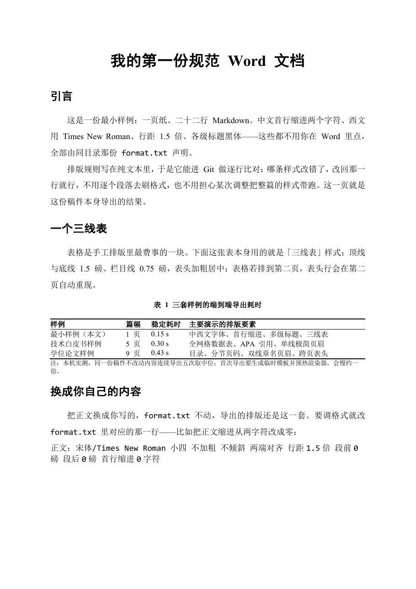
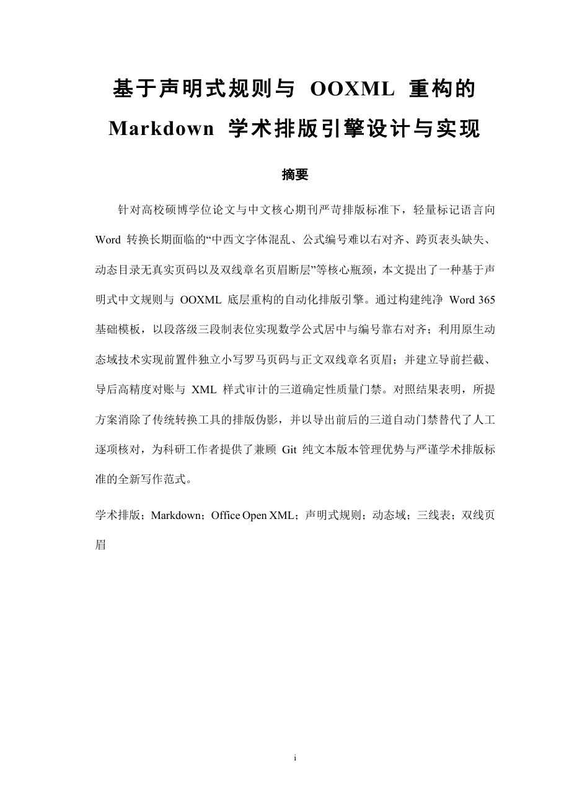
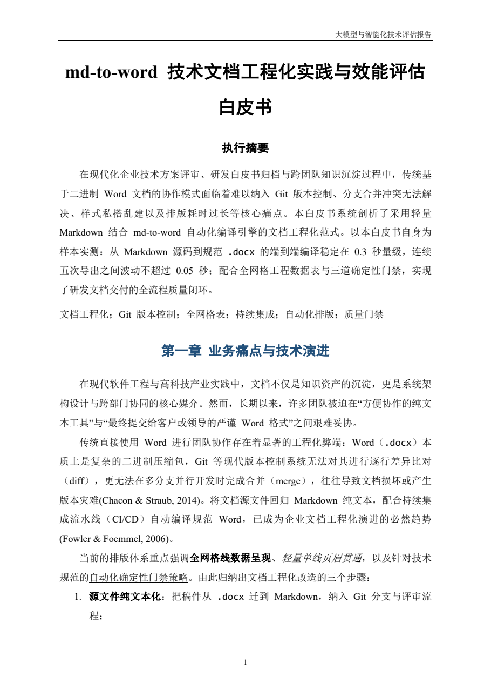
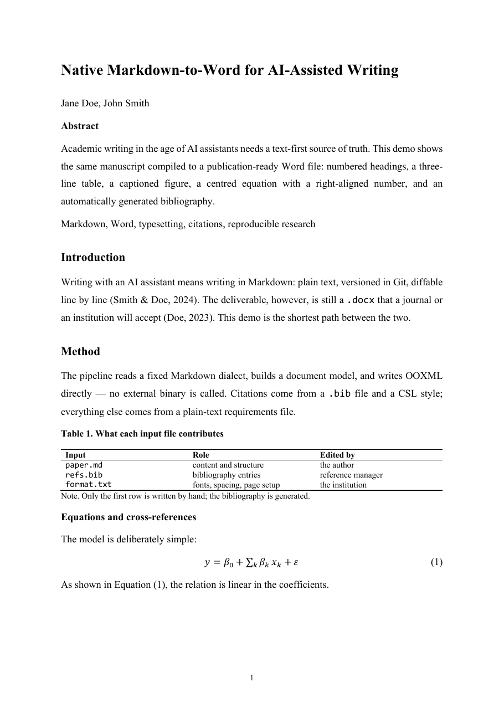

<!-- mcp-name: io.github.ls-open/md-to-word -->

# md-to-word

[](https://github.com/Yuan1z0825/nature-skills/tree/main/skills/nature-paper2word)
[](https://github.com/Imbad0202/academic-research-skills/blob/main/THIRD_PARTY.md#listed-projects)
[](https://github.com/1c7/chinese-independent-developer/blob/master/.github/pages/README-Programmer-Edition.md)
[](https://glama.ai/mcp/servers/ls-open/md-to-word)
[](https://github.com/ls-open/md-to-word/releases)
[](https://github.com/ls-open/md-to-word/blob/main/LICENSE)
[](https://www.python.org/)

[English](README_EN.md) | **简体中文** | [在线样张预览](https://ls-open.github.io/md-to-word/)

把 Markdown 确定性编译为规范 Word（`.docx`）。专为学位论文、技术报告、学术论文与公文排版打造，也是面向 AI Agent 设计的确定性排版引擎。

解决通用工具导出 Word 时的格式漂移、公式无法二次编辑、三线表跨页无表头、无法独立分节分页码等问题。内容写在 Markdown 中，格式规则写在纯文本 `format.txt` 里，随稿件进 Git 版本管理。

---

### 成品效果

以下为实际导出的 Word 样张（由生成的 PDF 真实渲染，非示意图，[在线样张页](https://ls-open.github.io/md-to-word/) 可直接下载 `.docx` 成品核对）：

| <a href="demo/00_quickstart/hello.docx"></a> | <a href="demo/01_chinese_thesis/thesis_sample.docx"></a> | <a href="demo/02_modern_report/report_sample.docx"></a> | <a href="demo/03_english_paper/paper.docx"></a> |
|:--:|:--:|:--:|:--:|
| **最小起步样例**<br>一页纸最短路径 | **中文学位论文**<br>目录域 / 罗马页码 / 章名双线页眉 | **现代技术报告**<br>全网格表 / 引用块 / 彩色标题 | **英文期刊投稿**<br>APA 作者-年份制 / 交叉引用 |

> 💡 另含繁体中文期刊、党政机关公文正文（GB/T 9704）与 APA 7 学生论文样例（[`demo/04_zh_tw_paper`](demo/04_zh_tw_paper)、[`demo/05_gb9704`](demo/05_gb9704)、[`demo/06_apa_student`](demo/06_apa_student)），7 套样张的完整源码与格式文件详见 [demo/ 目录](demo/)。

---

### 快速开始

根据你的使用习惯选择接入方式：

#### 1. 终端命令行（CLI）

纯 Python 实现，不依赖 Pandoc、Quarto 或 Office：

```bash
# 1. 安装核心编译器
pip install md-to-word-docx

# 2. 初始化示例文件（写入 format.txt 与示例稿件）
md-to-word init

# 3. 编译导出
md-to-word hello.md -f format.txt -o hello.docx

# （可选）先只跑预检、不生成文件
md-to-word hello.md --validate-only

# （可选）没有格式文件时，使用内置学术预设快速出稿
md-to-word hello.md --preset zh-academic -o hello.docx

# （可选）给 Agent / 脚本的机器可读契约与结构化诊断
md-to-word --contract --json
md-to-word hello.md -o hello.docx --json
```

#### 2. AI 智能体（Claude Code / 终端 Agent）

作为 Agent Skill 接入，让 AI 按照规范排版并根据行号门禁自我修正：

```bash
# 通过 npx 直接安装技能
npx skills add ls-open/md-to-word
```

*说明：若已集成 [Nature Skills](https://github.com/Yuan1z0825/nature-skills)，直接对 AI 说“把论文导出为 Word”或“按学校规范排版”即可由 Agent 自动调度触发。*

#### 3. 桌面端 MCP（Claude Desktop / Cursor）

在客户端的 `mcpServers` 配置中添加（使用 `uvx` 自动隔离运行，无需手动配环境）：

```json
{
  "mcpServers": {
    "md-to-word": {
      "command": "uvx",
      "args": ["--from", "md-to-word-docx[mcp]", "md-to-word-mcp"]
    }
  }
}
```

---

### 核心特性

- **Word 原生数学公式**：输出原生 OMML 矢量公式（Word 中双击可二次编辑，非位图），公式绝对居中、编号精准靠右对齐，支持 `@eq-` 交叉引用。
- **学术三线表**：边框线宽精准可控；要求文件写「跨页重复」后，长表格跨页会重复表头（内置预设默认开启）。
- **独立分节与页码**：支持前置页罗马页码（`i, ii`）、正文阿拉伯页码（`1, 2`）独立计数，生成 Word 原生动态目录域（按 F9 刷新）与随章变换页眉。
- **29 套 CSL 参考文献**：内置国标 GB/T 7714、Nature、IEEE、APA 等常用样式，由 `.bib` 或 CSL-JSON（Zotero / Mendeley / Crossref 导出）自动生成引文列表。
- **带精确行号的双向门禁**：导前语法预检、导后防丢内容核对、底模 XML 样式对账。格式不合规时带行号报错中止，方便人类与 AI Agent 定位修改；`--validate-only` 可单独跑预检、不写文件。
- **输入编码从宽**：稿件、格式文件与 `.bib` 支持 UTF-8（含 BOM）、UTF-16 与 GB18030；非 UTF-8 会照常读取并提醒另存。
- **同一平台逐字节一致**：固定时间戳、权限与打包顺序，相同源文件在同系统下重复编译产物二进制完全一致，便于 Git 差异比对。

---

### 现成 Word 模板支持

- **反推格式声明**：从已有 `.docx` 模板反推 `format.txt`：
  ```bash
  md-to-word-template 模板.docx -o format.txt
  ```
- **正文灌入底模**：原样保留学校或单位模板的封面与授权书：
  ```bash
  md-to-word 论文.md -f format.txt --base-template 模板.docx --keep-until 作者签名 -o 论文.docx
  ```
  `--keep-until` 写你想保留的**最后一行**（含这一行）；单节模板会在这一段之后切开，想留整页就写这一页的最后一行。

---

### 常用写法速查

| 结构 | Markdown 语法 | 说明 |
|:--|:--|:--|
| **段落样式** | `%% 摘要 本文提出……` | 行首 `%% 样式名`，指定该段使用的排版样式 |
| **编号公式** | `$$E=mc^2$$ {#eq-mass}` | 独立成行；正文使用 `@eq-mass` 交叉引用 |
| **图表题注** | 表前 `%% 表题 **表 1** 数据对比`<br>图后 `%% 图片题注 图 1 架构图` | 题注与图表同页绑定，换页不分离 |
| **参考文献** | 正文 `[@smith2024]`，YAML 中声明 `bibliography: refs.bib` | 文献表按 CSL 样式自动渲染 |
| **结构标记** | ``、`` | 目录域、按节名切换页码与页眉页脚；各自独立成行 |

> 完整词表与规范详见[使用手册](src/md_to_word/resources/manual.md)，亦可运行 `md-to-word --contract` 打印。

---

### 已知局限

- **逐字节一致限同平台**：跨平台受系统底层 zlib deflate 压缩实现差异影响，二进制会略有不同。
- **不便支持的复杂版式**：受 Markdown 与单栏样式模型所限，暂不支持单元格合并、斜线表头、多栏混排及文字环绕浮动图。
- **PDF 导出**：`--pdf` 展开目录域依赖 macOS 系统的 Word 环境；无 Word 环境时跳过 PDF，`.docx` 正常生成。
- **字体与打开软件**：`.docx` 只记录字体名、不嵌入字体；打开机器缺少声明字体时 Word 会替换，分页可能变化。WPS 能打开，但目录域不会自动展开，`STYLEREF` 章名页眉可能显示错误；正式交付以 Microsoft Word 打开核对为准。

---

### 协同生态

- **[Nature Skills](https://github.com/Yuan1z0825/nature-skills)**：科研论文全流程写作 Agent 技能集。本项目的技能版已合并入该仓库（即 `nature-paper2word` 技能），负责终稿阶段的规范 Word 编译交付。
- **[Academic Research Skills](https://github.com/Imbad0202/academic-research-skills)**：由五个研究技能组成、采用十阶段流水线的学术研究框架。本项目被收录在其第三方项目列表中，在 Stage 5（FINALIZE）产出 Markdown 草稿与参考文献后，直接承接出规范 `.docx`。
- **[中文独立开发者](https://github.com/1c7/chinese-independent-developer/blob/master/.github/pages/README-Programmer-Edition.md)**：收录于程序员专刊精选独立项目。

---

### 许可

[MIT License](LICENSE)。内置 CSL 样式来自 [citation-style-language/styles](https://github.com/citation-style-language/styles)（CC BY-SA 3.0）。
