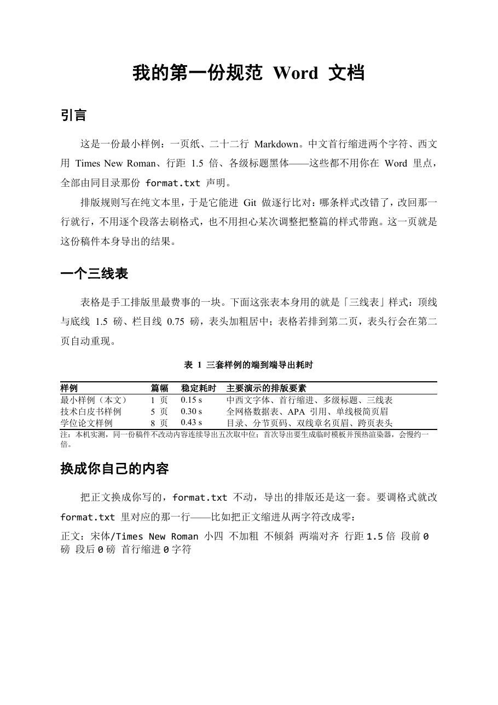
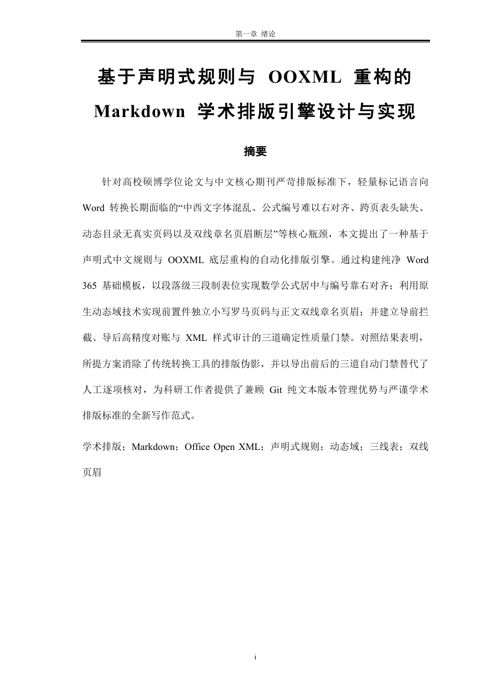
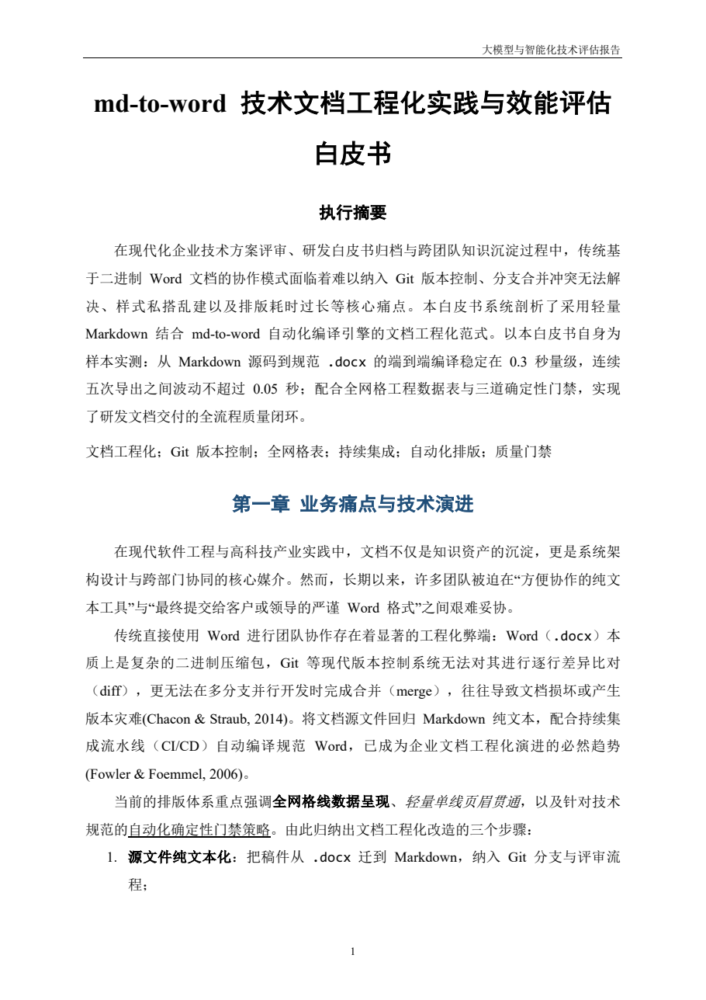
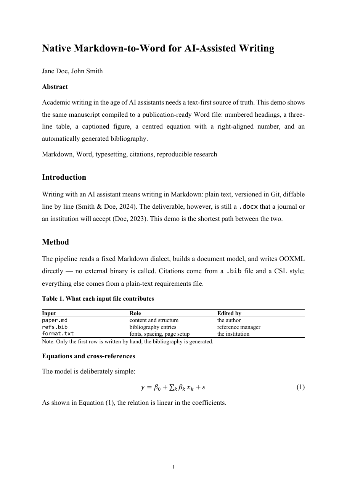

<!-- mcp-name: io.github.ls-open/md-to-word -->

# md-to-word

[](https://github.com/Yuan1z0825/nature-skills/tree/main/skills/nature-paper2word)
[](https://github.com/Imbad0202/academic-research-skills/blob/main/THIRD_PARTY.md#listed-projects)
[](https://github.com/1c7/chinese-independent-developer/blob/master/.github/pages/README-Programmer-Edition.md)
[](https://github.com/ls-open/md-to-word/releases)
[](https://github.com/ls-open/md-to-word/blob/main/LICENSE)
[](https://www.python.org/)

[English](https://github.com/ls-open/md-to-word/blob/main/README_EN.md) | **简体中文** | [在线样张](https://ls-open.github.io/md-to-word/)

把 Markdown 确定性编译为规范 Word（`.docx`）。专为学位论文、技术报告、学术论文、公文打造，**也是面向 AI Agent 设计的确定性 Word 格式编译底座**。

> 🌐 **先看成品**：[四套内置格式的在线样张](https://ls-open.github.io/md-to-word/)——公式、三线表、页眉、引文都是真的排出来的，`.docx` 可直接下载，用 Word 打开就是成品。

---

### 为什么需要 md-to-word？

大模型直接编写 `python-docx` 脚本极易产生格式漂移、表格断裂或样式幻觉；而通用工具（如 Pandoc）改动细节需深入修改复杂底模与后处理过滤器。

`md-to-word` 采用**声明式排版契约**与**带精确行号的双向质量门禁**：
- **逐字节一致**：同一平台上，同一份源文件重复编译，产物二进制完全一致——打包时间戳、权限、条目顺序与平台标识均已固定（换平台的差异见[已知局限](#已知局限)）；
- **产物自证出处**：`docProps` 里记着版本、格式文件名与它的 sha256 前八位；不写时间戳，所以重复导出仍逐字节一致；
- **自愈门禁**：格式没写全或语法错误，导出前精准指示行号并给出改法，Agent 可据此自行修正后重跑；
- **规范排版**：原生 OMML 矢量数学公式（双击可编辑、自动居中、编号靠右）、跨页自动重复表头三线表、双线/单线页眉、中西文字体分离。
- **用户格式优先**：有模板或书面要求时，按其 `format.txt` 编译；没有具体要求时可先用内置预设看效果，正式交付仍以模板或规范为准。

---

## 架构认知：自包含核心与多形态接入

> 💡 **设计要点**：
> 底层是一个确定性的 Python 编译引擎（`md-to-word-docx`），排版契约规范与自检逻辑都在包里。为解决「契约升级后，外部 Prompt 与技能文档随之失效」的问题，规范采用**随包自包含**的方式发布：`md-to-word --guide` 输出的就是与代码同版本的那一份。
> 无论你是想在网页上先看成品、在桌面端挂载为原生 AI 工具（MCP）、在智能体中作为技能（Skill）调用，还是在终端执行 CLI 批处理，底层运行的都是同一套严格对账的编译逻辑。

### 选型对比与使用全景

| 使用形态 | 适用客户端 / 场景 | 本地环境依赖 | 接入方式 | 核心特点与适用建议 |
| :--- | :--- | :---: | :--- | :--- |
| **🌐 在线样张** | 先看效果，再决定装不装 | ❌ 无需安装任何环境 | 直接访问 [官方样张页](https://ls-open.github.io/md-to-word/) | **免安装**：四套内置格式的成品与规格清单，`.docx` / `.pdf` 直接下载；每一份都是 `python3 web/build.py` 现场导出的，可复核。 |
| **🤖 MCP 原生外设** *(格式确定之后)* | **Claude Desktop**、**Cursor**、**Windsurf** 等支持 MCP 协议的 AI 桌面端 | ❌ 无需手动配 Python（`uvx` 自动拉取） | 在客户端配置中声明 `uvx` 命令（见下文） | **原生**：已经拿到 `format.txt` 后，让 AI 直接编译；环境在独立虚拟环境里。 |
| **🧠 Agent Skill 技能** *(推荐)* | **Claude Code**、**终端 Agent**、**Nature Skills** | ⚠️ 依赖宿主 Agent 执行环境 | `npx skills add ls-open/md-to-word` 或呼叫 `$nature-paper2word` | **按规范排**：AI 先读规范、按用户模板/要求定格式，遇门禁读行号自愈重跑。 |
| **💻 本地 CLI 与 SDK** | 终端命令行批处理、CI/CD 自动化流水线、Python 脚本开发 | 需 Python >= 3.10 | `pip install md-to-word-docx` 然后运行 `md-to-word 稿.md` | **纯本地**：不依赖任何大模型 API，支持模板样式反推与逐字节回归测试。 |

---

### 快速上手指南

#### 1. 🤖 作为 MCP 原生外设使用（Claude Desktop / Cursor）

MCP（Model Context Protocol）是 Anthropic 开源的标准模型上下文协议。AI 客户端不需要运行在命令行中，直接通过标准协议将 `md-to-word` 当作专属排版外设调用。

**为什么无需手动安装？**  
推荐使用现代 Python 工具链 `uvx`，它会在首次调用时**自动从 PyPI 下载依赖并在隔离环境中执行**，无需污染全局系统。

在你的 `claude_desktop_config.json`（或 Cursor MCP 配置）中添加：

```json
{
  "mcpServers": {
    "md-to-word": {
      "command": "uvx",
      "args": ["--from", "md-to-word-docx[mcp]", "md-to-word-mcp"]
    }
  }
}
```

*（注：若习惯本地全局 Python 环境，亦可运行 `pip install "md-to-word-docx[mcp]"`，并将 `command` 设为 `python3`，`args` 设为 `["-m", "md_to_word.mcp"]`）*

**AI 自动获得的原生能力**：
- `compile_markdown`：将输入的 Markdown（文本或文件路径）直接编译为规范 `.docx`（并可按需转为 PDF）；
- `validate_manuscript`：在生成前执行预检，自动检测未闭合的数学公式、缺线的表格或格式错误；
- `get_guide` / `get_manual`：读取包内的工作流指南与完整词表；
- `extract_format_from_docx`：从已有参考 `.docx` 模板反推 `format.txt` 草稿；
- `list_presets`：按需选择简体学术（`zh-academic`）、繁体学术（`zh-tw-academic`）、技术报告（`zh-report`）或英文期刊预设（`en-nature`）；
- `inspect_preset`：查阅任意内置预设的完整字体、行距与排版规则（`format.txt`）。

**使用顺序**：先让 Agent 调用 `get_guide`，若有具体模板或格式要求则提取或编写 `format.txt`，无特殊要求则直接选用内置预设。可以直接给 Agent 这条提示：

> 先运行 `md-to-word --guide` 读完整工作流；如果有目标模板或规范要求，先用 `md-to-word-template` 反推出 `format.txt` 再编译；若无特殊要求，直接使用内置预设快速出稿。

#### 2. 🧠 作为 Agent Skill 技能使用（Claude Code / Nature 生态）

如果你在命令行或具备 Shell 权限的 Agent（如 Claude Code、OpenCode）中使用：

- **npx 安装**：
  ```bash
  npx skills add ls-open/md-to-word
  ```
- **Nature Skills 生态内置**：
  本项目的技能版已合并入 [Nature Skills](https://github.com/Yuan1z0825/nature-skills)，已安装环境直接输入 `$nature-paper2word` 即可唤起。
- **手动导入**：
  将仓库中的 [`SKILL.md`](https://github.com/ls-open/md-to-word/blob/main/SKILL.md) 复制到你项目的技能目录（如 `.claude/skills/`）即可。
- **CodeBuddy 插件市场**：
  ```bash
  /plugin marketplace add ls-open/md-to-word
  /plugin install md-to-word@md-to-word-marketplace
  ```

#### 3. 💻 本地 pip 安装与命令行直接运行

如果你需要脱离大模型直接作为本地生产力工具使用：

```bash
# 安装核心编译器
pip install md-to-word-docx

# 初始化示例项目（写入 format.txt 与一篇可直接导出的样例）
md-to-word init

# 查看完整工作流与格式词表
md-to-word --guide

# 导出（把 hello.md 换成你的稿件）
md-to-word hello.md -f format.txt -o hello.docx

# 没有格式文件时，用内置预设先看效果（仅预览）
md-to-word hello.md --preset zh-academic -o 预览.docx
```

- **作为 Python 库调用**：
  ```python
  from md_to_word import export

  result = export("稿件.md", "稿件.docx", format="format.txt")
  if not result.ok:
      raise SystemExit("\n".join(result.errors))
  ```

---

## 样例展示

以下样例均由真实编译流程生成，页图由生成的 PDF 真实渲染，非效果图：

| <a href="https://github.com/ls-open/md-to-word/blob/main/demo/00_quickstart/hello.docx"></a> | <a href="https://github.com/ls-open/md-to-word/blob/main/demo/01_chinese_thesis/thesis_sample.docx"></a> |
|:--:|:--:|
| **最小起步样例** · 一页纸，从稿件到成品的最短路径 | **中文学位论文** · 目录域、分节页码、按章编号、双线章名页眉 |
| <a href="https://github.com/ls-open/md-to-word/blob/main/demo/02_modern_report/report_sample.docx"></a> | <a href="https://github.com/ls-open/md-to-word/blob/main/demo/03_english_paper/paper.docx"></a> |
| **现代技术白皮书** · 全网格表、引用块、彩色一级标题 | **英文期刊投稿** · APA 作者-年份制、`Equation 1` 交叉引用 |

---

## 手上有现成的 Word 模板？（反推格式 / 灌入正文）

学校、期刊或单位下发的 `.docx` 模板不必逐条手工抄写。使用内置的模板反推器：

```bash
md-to-word-template 学校模板.docx -o format.txt
```

反推器解析页面尺寸、页边距、装订线、页码样式，以及各级样式的字体、字号、行距、段距、缩进与表格边框。**判定不出来的、以及读得出来但格式文件表达不了的（方框、底纹、页眉里的图片），会逐条列在那份 format.txt 末尾的待确认清单里**，不猜值填空。

如果连封面和原创性声明也要**原样保留**，就不要反推——把那份 `.docx` 当底模，正文灌进去，前置件一个字节不动：

```bash
md-to-word 论文.md -f format.txt --base-template 学校模板.docx --keep-until 版权使用授权书 -o 论文.docx
```

`--keep-until` 按内容定位，比 `--cover-sections N` 稳：工具自己换算成第几节并报出来。**底模里若有目录，切点必须停在它之前**——目录由稿件里的 `` 生成，页码才是对的；切深了直接拒绝并说明最多能留几节。

> **验不过就不产出文件**：结构比对跨平台必做，版面逐页比对只在装了 Word 的 macOS 上做，届时会说明验到了哪一层（「逐节点一致」还是「逐页一致」）。详见包内手册 §9（`md-to-word --contract` 给出路径）。

---

## 排版能力一览

- **页面与正文**：纸张、页边距、原生装订线与双面镜像页边距、文档网格、简繁/西文字体（含 `zh-tw-academic` 繁中预设）、标点压缩策略、字号、行距、缩进、段距、对齐、样式级颜色
- **标题与页眉页脚**：六级标题、奇偶页与首页不同、分节、页码格式与起始、`{页码}` `{总页数}` `{样式标题:Heading 1}` 域
- **表格**：三线表、全网格线、顶底线、无边框，线宽、跨页重复表头、单元格垂直水平对齐、列宽比例
- **公式**：原生 OMML 公式对象（Word 内可直接双击二次编辑，不是位图），居中、编号靠右、按章编号、`@eq-` 交叉引用
- **图、表与题注**：图片宽度按版心智能钳制，题注与图表同页绑定防掉页，直接支持矢量 PDF 插图（导出时自动 300 dpi 高清栅格化）
- **文献与引用**：`.bib` + CSL 样式体系，内置 29 份常用期刊与国家标准样式（GB/T 7714、APA、Nature、IEEE 等），支持自定义 CSL
- **行内样式**：加粗、斜体、删除线、下划线、上下标、行内代码、行内公式、超链接、脚注
- **结构标记**：目录域 ``、分节换页码 ``、分页 ``
- **质量门禁**：导前预检（契约、样式、引文合法性）、导后防丢数核对、逐条样式对账
- **纯 Python 本地导出**：`.docx` 整条链路在 Python 进程内完成，不依赖 Office / WPS / Pandoc（`--pdf` 核对版是例外：那一步要 macOS 上的 Word 展开域）

完整功能边界与词表详见[使用手册](https://github.com/ls-open/md-to-word/blob/main/src/md_to_word/resources/manual.md)。

---

## 已知局限

上一节是能做到的，这里列**做不到的和权衡后不做的**，每条说明原因：

- **「逐字节一致」只在同一平台内成立。** 时间戳、权限、条目顺序都已钉死，但 deflate 压缩流的字节取决于 zlib 的实现与版本——macOS 的系统 zlib 与 Windows 上 CPython 自带的那份打出来内容一致、字节不同。跨平台比对二进制因此必然不一致；换机器核对时比对内容，而不是比对字节。
- **`--pdf` 只在 macOS + Word 上。** 目录、`STYLEREF` 页眉章名、页码这些域只有 Word 会真正展开。没有 Word 时 `.docx` 照常产出，PDF 跳过并在日志里说明；Linux / Windows 上不产出 PDF。
- **中英混排的 CSL 多语种 layout 不支持。** 引文引擎（citeproc-py）不实现 CSL-M，一份文献表只能按一种 locale 排；纯中文或纯英文文献库正常，混排需按主体语言二选一，或导出后手改。
- **合并单元格、斜线表头、行内改文字颜色、多栏、文字环绕的浮动图：不支持。** 前三个受 Markdown 与样式模型的边界所限，后两个受单栏正文版式所限；每一类的替代做法见手册 §6。
- **列表项里放围栏代码块会中止导出并报错**，而不是把代码块静默挪成顶层段落。这与其余门禁同一条原则：宁可停下报错，也不输出排错的文档。

完整的硬边界、CSL 排版差异清单与静默钳制规则见[手册 §6 能力边界](https://github.com/ls-open/md-to-word/blob/main/src/md_to_word/resources/manual.md#6-能力边界)。

---

## 常用写法速查

只列这套契约特有的写法；完整词表以 `md-to-word --contract` 为准（该命令打印的速查表随代码版本同步，本表只是它的摘要）。

| 要写的内容 | 写法 | 说明 |
|:--|:--|:--|
| **指定段落样式** | `%% 摘要 本文提出……` | 行首 `%% 样式名`，一行即一段，无闭合符号 |
| **带编号公式** | `$$E=mc^2$$ {#eq-mass}` | 单独成行；正文用 `@eq-mass` 引用，不带方括号 |
| **图表题注** | 表前 `%% 表题 **表 1** 耗时对比`<br>图下一行 `%% 图片题注 图 1 系统架构` | 题注与图表自动绑定同页，不分离 |
| **参考文献** | 正文 `[@smith2024]`，YAML 声明 `bibliography: refs.bib` | 文献表由引文引擎生成，顺序与格式随 CSL 样式 |
| **结构标记** | ``、``、`` | 目录域、分节换页码、强制分页；各自单独成行 |

---

## 与其他方案的区别

| 维度 | Pandoc / Quarto | 传统 Markdown→Word 脚本库 | 本项目 (md-to-word) |
|:--|:--|:--|:--|
| **排版规则维护** | 命令行复杂参数 + Word 底模，改细节需动内部 XML | 硬编码在 Python 代码中，或只有粗粒度预设 | 一份纯文本 `format.txt`，随稿件进 Git，所见即声明 |
| **公式排版** | 需额外后处理脚本实现靠右编号 | 很多转为图片或字面代码 | 原生 OMML 数学公式，自动居中，编号严格靠右 |
| **分节与页眉页脚** | 必须手工预先修改底模并插域 | 普遍不支持复杂分节 | 标记声明（如目录罗马数字、正文阿拉伯数字分节） |
| **错误诊断** | 静默走样或布局断裂 | 多数直接抛异常，不带行号 | 导前预检并精确指示**第几行**，出错可定位到源文件 |
| **与 Agent 协作** | 难以通过 Prompt 控制细节 | 每次生成的脚本都不同 | 规范、词表与报错都面向「读规范 → 调工具 → 读报错重跑」设计 |

---

## 协同生态与收录

本项目专注下游的高质量确定性排版与 Word 交付，前期的文献调研、开题构思与论文写作推荐配合以下学术 Agent 框架：

- **[Nature Skills](https://github.com/Yuan1z0825/nature-skills)**：科研论文全流程写作 Agent 技能集。本项目的技能版已合并入该仓库，负责终稿阶段的规范 Word 编译交付，在 Nature Skills 环境中可直接唤起 `$nature-paper2word`。
- **[Academic Research Skills](https://github.com/Imbad0202/academic-research-skills)**：由五个研究技能组成、采用十阶段流水线的学术研究框架。本项目被收录在其第三方项目列表中，在 Stage 5（FINALIZE）产出 Markdown 草稿与参考文献后，直接承接出规范 `.docx`。
- **[中文独立开发者](https://github.com/1c7/chinese-independent-developer/blob/master/.github/pages/README-Programmer-Edition.md)**：收录于程序员专刊精选独立项目。

---

## 许可

代码开源遵循 [MIT License](https://github.com/ls-open/md-to-word/blob/main/LICENSE)。  
内置引文样式来自 [citation-style-language/styles](https://github.com/citation-style-language/styles)（CC BY-SA 3.0）；内置底模由本项目生成，随 MIT 发布。
