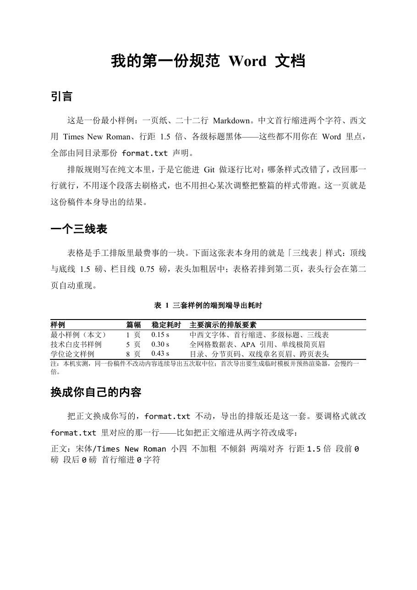
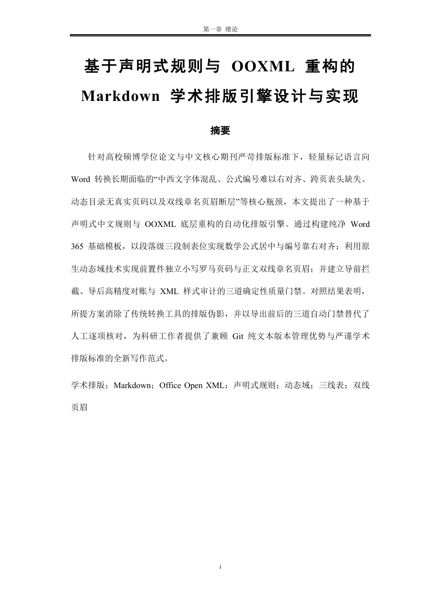
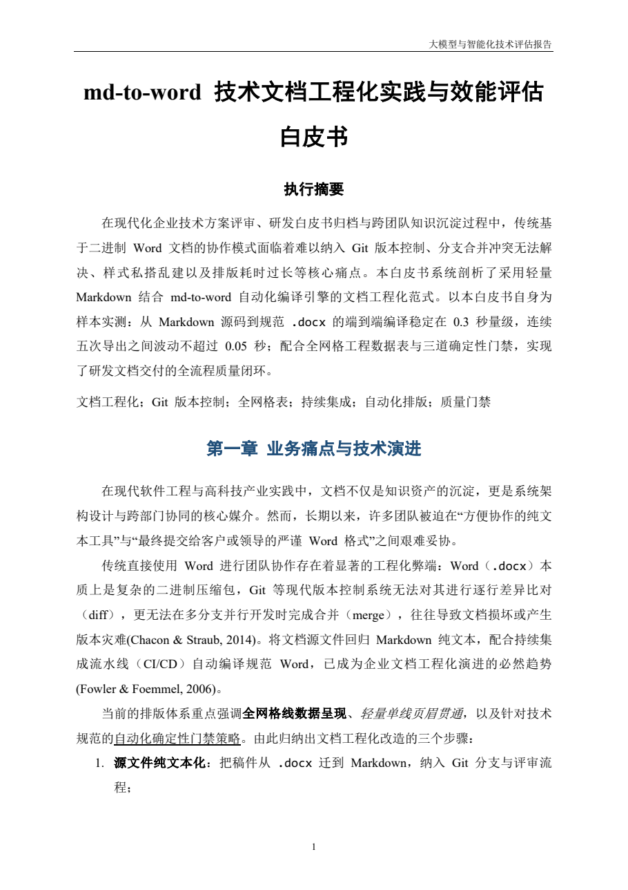
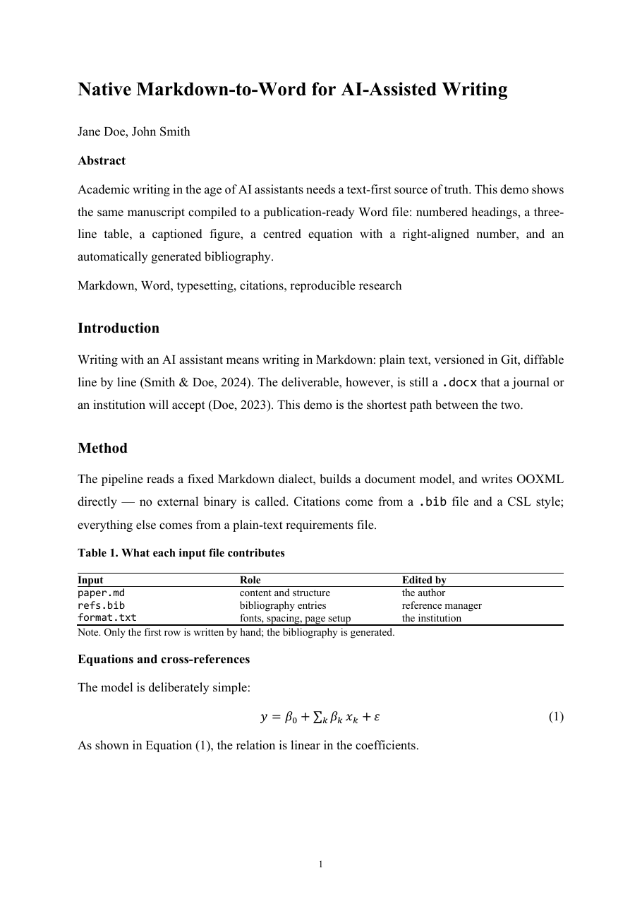

# md-to-word

[](https://github.com/Yuan1z0825/nature-skills/tree/main/skills/nature-paper2word)
[](https://github.com/Imbad0202/academic-research-skills/blob/main/THIRD_PARTY.md#listed-projects)
[](https://github.com/1c7/chinese-independent-developer/blob/master/.github/pages/README-Programmer-Edition.md)
[](https://github.com/ls-open/md-to-word/releases)
[](https://github.com/ls-open/md-to-word/blob/main/LICENSE)
[](https://www.python.org/)

**English** | [简体中文](https://github.com/ls-open/md-to-word/blob/main/README.md) | [Sample Gallery](https://ls-open.github.io/md-to-word/)

Compile Markdown into compliant Word (`.docx`) documents matching strict formatting specifications. Designed for academic papers, theses, technical reports, and official documents — **and built as a deterministic Word compilation engine for AI Agents**.

> 🌐 **See the output first**: [the sample gallery](https://ls-open.github.io/md-to-word/) shows four built-in formats — equations, three-line tables, running headers and citations, actually typeset. Download the `.docx`; what opens in Word is the real thing.

---

### Why md-to-word?

Prompting LLMs to hand-write `python-docx` scripts often leads to formatting hallucinations, table drifts across page breaks, and styling inconsistencies. Tools like Pandoc require wrestling with complex internal XML templates and brittle post-filters for fine adjustments.

`md-to-word` uses a **declarative typographic contract** and **bidirectional quality gates with exact line numbers**:
- **Byte-Identical Reproducibility**: On the same platform, rebuilding the same Markdown source yields identical document binaries — packaging timestamps, permissions, entry order and the zip platform byte are all fixed (cross-platform differences are covered under [Known Limitations](#known-limitations)).
- **Self-Describing Output**: `docProps` records the version, the format file name and the first 8 hex digits of its sha256; no timestamp is written, so repeated exports stay byte-identical.
- **Actionable errors**: Missing formats or invalid syntax are caught before the file is written, with exact line numbers and the fix, so an Agent can correct the manuscript and re-run.
- **Compliant Typography**: Native OMML math formulas (vector, double-click editable, centered with numbering hard right), three-line tables with repeating headers across page breaks, and double/single-rule running headers.
- **User format first**: When a template or written spec is available, compile against its format file; built-in presets are for a first look, while a deliverable should follow the template or spec.

---

## Architectural Design: Self-Contained Engine & Multi-Modal Access

> 💡 **Design**:  
> At the foundational layer lies a deterministic Python compilation engine (`md-to-word-docx`), with the typographic contract and its self-checks inside the package. So that an upgrade of the contract cannot leave external prompts and skill documents behind, the specification ships **with the package**: `md-to-word --guide` prints exactly the version that matches the code.  
> Whether you look at the finished output in your browser, mount it into desktop AI clients via MCP, inject it into autonomous agents as a Skill, or run batch jobs in the terminal, the identical deterministic pipeline executes underneath.

### Usage & Ecosystem Matrix

| Mode | Target Clients & Use Cases | Local Environment | Quick Start / Launch Command | Key Strengths |
| :--- | :--- | :---: | :--- | :--- |
| **🌐 Sample Gallery** | See the output before installing anything | ❌ None needed | Visit the [official gallery](https://ls-open.github.io/md-to-word/) | **No install**: four built-in formats with their typographic contracts; download `.docx` / `.pdf`. Every sample is exported by `python3 web/build.py` and can be re-checked. |
| **🤖 MCP Native Server** *(once the format is fixed)* | **Claude Desktop**, **Cursor**, **Windsurf**, and any MCP client | ❌ Handled automatically (`uvx` pulls isolated venv) | Add `uvx` configuration (see below) | **Native**: once a `format.txt` exists, the AI compiles directly; the environment runs in an isolated venv. |
| **🧠 Agent Skill** *(Recommended)* | **Claude Code**, terminal agents, **Nature Skills** | ⚠️ Requires host agent environment | `npx skills add ls-open/md-to-word` or `$nature-paper2word` | **Format-driven**: reads the guide, derives the format from the user's template/spec, and self-heals on gate errors. |
| **💻 Local CLI & SDK** | Terminal batch processing, CI/CD pipelines, Python scripts | Requires Python >= 3.10 | `pip install md-to-word-docx` then `md-to-word paper.md` | **Fully local**: no LLM API dependency, supports reverse template extraction and byte-level diffs. |

---

### Quick Start Guides

#### 1. 🤖 Use as an MCP Server (Claude Desktop / Cursor)

The Model Context Protocol (MCP) by Anthropic lets AI clients connect to `md-to-word` as a native publishing tool.

**Why no manual installation is needed?**  
Using `uvx` (from Astral), the client downloads and executes the package in a transient, isolated virtual environment on first demand without cluttering your system Python.

In your `claude_desktop_config.json` (or Cursor MCP settings), add:

```json
{
  "mcpServers": {
    "md-to-word": {
      "command": "uvx",
      "args": ["--from", "md-to-word-docx[mcp]", "md-to-word-mcp"]
    }
  }
}
```

*(Note: For local Python environments, install via `pip install "md-to-word-docx[mcp]"`, then set `command: "python3"` and `args: ["-m", "md_to_word.mcp"]`)*

**Capabilities Granted to Your AI**:
- `compile_markdown`: Compiles raw Markdown strings or local `.md` files directly into `.docx` documents;
- `validate_manuscript`: Runs preflight validation gates (unclosed math formulas, broken table lines, unresolved CSL citations);
- `get_guide` / `get_manual`: Reads the packaged workflow guide and full vocabulary;
- `extract_format_from_docx`: Reverse-engineers a draft `format.txt` from an existing reference `.docx`;
- `list_presets`: Explores built-in presets (`zh-academic`, `zh-tw-academic` Traditional Chinese, `zh-report`, `en-nature`);
- `inspect_preset`: Inspects full typography rules (`format.txt`) for any preset.

**Order of work**: call `get_guide` first, then decide `format` from the user's template or spec; use a built-in preset only for a first look when no template is available.

#### 2. 🧠 Use as an Agent Skill (Claude Code / Nature Ecosystem)

For CLI agents or environments with shell execution permissions:

- **Automated CLI Installation**:
  ```bash
  npx skills add ls-open/md-to-word
  ```
- **Nature Skills Integration**:
  The skill version is merged into **[Nature Skills](https://github.com/Yuan1z0825/nature-skills)**. Simply call `$nature-paper2word` in supported setups.
- **Manual Import**:
  Copy [`SKILL.md`](https://github.com/ls-open/md-to-word/blob/main/SKILL.md) into your project's rules or skills directory (e.g. `.claude/skills/`).

#### 3. 💻 Local pip Installation & Direct CLI Usage

For direct terminal productivity without LLMs:

```bash
# Install core compiler
pip install md-to-word-docx

# Scaffold sample workspace (English samples: add `--lang en --preset en-nature`)
md-to-word init

# Read complete self-contained contract and guide
md-to-word --guide

# Compile with an explicit format file (hello.md is what `init` wrote)
md-to-word hello.md -f format.txt -o hello.docx

# Without a format file, use a preset for a first look (preview only)
md-to-word hello.md --preset en-nature -o preview.docx
```
If you prefer direct Python CLI usage or operate in a local terminal / editor Agent environment:

1. **Install the Compiler**:
   ```bash
   pip install md-to-word-docx
   ```
   *(Note: The PyPI package name is `md-to-word-docx`, while the installed command remains `md-to-word`. Use `pipx install md-to-word-docx` for isolated environments, and update via `pip install -U md-to-word-docx`)*

2. **Core Principle & Prompting AI**:  
   The package includes a complete guide identical to `SKILL.md`. When interacting with an Agent, **prompt it to read the guide first**:

   > 💬 **Standard Prompt Template (Ready to copy):**  
   > "I have installed `md-to-word-docx`. Please first run `md-to-word --guide` to understand its formatting rules and contracts, then help me format the manuscript in this directory into a compliant Word document (if a template Word file is available, run `md-to-word-template` first to deduce the format file)."

3. **Autonomous AI Execution Loop**:
   - **Read specs**: Runs `md-to-word --guide` (or `--contract`) to understand closed vocabulary and Markdown contracts.
   - **Define rules**: Generates or adjusts `format.txt`, or deduces from an existing `.docx` template.
   - **Compile**: Runs `md-to-word manuscript.md -f format.txt -o manuscript.docx --json`.
   - **Self-heal**: If intercepted by preflight gates, fixes issues automatically based on reported line numbers until exit code is `0`.

---

### For Developers and Automated Pipelines (Optional)

If you need to call the engine directly in scripts or CI/CD pipelines:

- **CLI Usage**:
  ```bash
  # Initialize minimal sample
  md-to-word init
  # Compile with an explicit format file
  md-to-word manuscript.md -f format.txt -o output.docx
  ```
- **Python API**:
  ```python
  from md_to_word import export

  result = export("manuscript.md", "manuscript.docx", format="format.txt")
  if not result.ok:
      raise SystemExit("\n".join(result.errors))
  ```

---

## Gallery

Generated through the genuine compilation pipeline; page snapshots rendered from actual PDF exports:

| <a href="https://github.com/ls-open/md-to-word/blob/main/demo/00_quickstart/hello.docx"></a> | <a href="https://github.com/ls-open/md-to-word/blob/main/demo/01_chinese_thesis/thesis_sample.docx"></a> |
|:--:|:--:|
| **Minimal Quickstart** · Single page, shortest path from draft to Word | **Academic Thesis** · TOC field, sectional pagination, double-rule header |
| <a href="https://github.com/ls-open/md-to-word/blob/main/demo/02_modern_report/report_sample.docx"></a> | <a href="https://github.com/ls-open/md-to-word/blob/main/demo/03_english_paper/paper.docx"></a> |
| **Technical White Paper** · Full grid table, blockquotes, color headings | **English Journal** · APA author-date citation, `Equation 1` cross-refs |

---

## Have an Existing Word Template? (deduce the format / pour in the body)

No need to transcribe guidelines manually from `.docx` files issued by publishers or universities. Use the built-in deduction tool:

```bash
md-to-word-template university_template.docx -o format.txt
```

It extracts page dimensions, margins, gutter, page-number style, and each style's fonts, sizes, line
spacing, paragraph spacing, indentation and table borders into a `format.txt`. **Anything it could not
determine — or could read but cannot express (boxes, shading, images inside headers) — is collected
into an item-by-item checklist at the end of that file**, and is never guessed.

If the cover page and originality statement must survive **untouched**, don't reverse-engineer — use that `.docx` as the base and pour the body in:

```bash
md-to-word thesis.md -f format.txt --base-template school.docx --keep-until "copyright authorization" -o thesis.docx
```

`--keep-until` locates by content and is more reliable than `--cover-sections N`: the tool converts it
to a section number and reports it. **The contents page is never kept**: if the base has one, the cut
must stop before it — your manuscript writes `` to generate it, which is the only way its page
numbers come out right. Cutting too deep is refused, and the message names the most you may keep.

> **A run either verifies or writes nothing.** The structural check runs everywhere; the page-by-page layout comparison needs Word on macOS, and the run says which layer it reached (the log says "node-for-node" or "page-for-page"). See §9 of the packaged manual (`md-to-word --contract` prints its path).

---

## Typography Capabilities

- **Page & Prose**: Paper size, margins, native gutters, double-sided mirror margins, document grid, Simplified/Traditional Chinese (`zh-tw-academic`) and Latin fonts, punctuation compression controls, sizes, line spacing, indents, paragraph spacing, alignments, style-level colors.
- **Headings & Headers/Footers**: 6 heading levels, odd/even/first-page distinctions, sectional pagination, `{page}` `{total-pages}` `{style-title:Heading 1}` fields.
- **Tables**: Three-line tables, full grid, top/bottom rules, custom borders, repeating header rows, vertical/horizontal alignment, column width ratios.
- **Equations**: Native OMML equation objects (double-click editable in Word; not images), centered, right-aligned numbering, chapter numbering, `@eq-` cross-references.
- **Figures, Tables & Captions**: Width clamped to body margins, keep-with-next binding so a caption never leaves its figure or table, native vector PDF image support (auto-rasterized to 300 dpi on export).
- **Citations & Bibliography**: `.bib` + CSL system with 29 built-in standard styles (GB/T 7714, APA, Nature, IEEE), custom CSL support.
- **Inline Formatting**: Bold, italic, strikethrough, underline, sub/superscript, inline code, inline math, hyperlinks, footnotes.
- **Structure**: Native TOC fields ``, section breaks ``, page breaks ``.
- **Quality Gates**: Preflight syntactic and citation validation, post-export integrity checks, granular style accounting.
- **Pure Python**: The `.docx` pipeline is self-contained — zero dependency on Microsoft Word, WPS, or Pandoc. The `--pdf` review copy is the exception: that step needs Word on macOS to expand the fields.

Refer to the [User Manual](https://github.com/ls-open/md-to-word/blob/main/src/md_to_word/resources/manual_en.md) for full boundaries and vocabulary.

---

## Known Limitations

The previous section is what it does. This one lists what it **cannot** do, or deliberately does not, with the reason for each:

- **"Byte-identical" holds within one platform only.** Timestamps, permissions and entry order are pinned, but the bytes of the deflate stream depend on the zlib implementation and version — macOS's system zlib and the one bundled with CPython on Windows produce the same content with different bytes. Binary comparison across platforms therefore always differs; compare content when checking across machines.
- **`--pdf` requires macOS with Word.** The TOC, `STYLEREF` chapter names in headers and page numbers are fields only Word actually expands. Without Word the `.docx` is still produced, the PDF step is skipped and logged; Linux and Windows never produce a PDF.
- **Mixed Chinese/English CSL layouts are not supported.** The citation engine (citeproc-py) does not implement CSL-M, so one bibliography can only render in one locale. Pure Chinese or pure English libraries are fine; for mixed libraries pick the dominant language, or fix the entries in Word afterwards.
- **Merged cells, diagonal header rules, inline text color, multi-column and floating wrapped figures are not supported.** The first three are limits of Markdown and the style model, the last two of the single-column body layout. Alternatives for each are in manual §6.
- **A fenced code block inside a list item aborts the export and reports an error** rather than silently hoisting the block to top level. This follows the same rule as every other gate: stop and report, instead of emitting a mis-formatted document.

The complete hard boundaries, CSL rendering deviations and silent-clamping rules live in [Manual §6](https://github.com/ls-open/md-to-word/blob/main/src/md_to_word/resources/manual_en.md).

---

## Syntax Cheat Sheet

Only the syntax specific to this contract is listed here; the authoritative list is `md-to-word --contract`, which prints a cheatsheet that ships with the code. This table is its summary.

| Element | Syntax | Note |
|:--|:--|:--|
| **Paragraph Style** | `%% Abstract Text here...` | Prefix line with `%% styleName`; one line per paragraph |
| **Numbered Equation** | `$$E=mc^2$$ {#eq-mass}` | Standalone line; referenced as `@eq-mass` without brackets |
| **Figure / Table Caption** | Before a table: `%% Table Caption **Table 1** Benchmark`<br>Line after a figure: `%% Figure Caption Fig. 1 Architecture` | Caption stays bound to its float and does not separate across pages |
| **Citation** | `[@smith2024]` in the body, `bibliography: refs.bib` in YAML | The bibliography is generated by the citation engine, ordered by the CSL style |
| **Structure Markers** | ``, ``, `` | TOC field, section break with page-number restart, forced page break; each on its own line |

---

## Ecosystem & Listed In

Focused on deterministic downstream Word compilation. Recommended to pair with upstream research frameworks:

- **[Nature Skills](https://github.com/Yuan1z0825/nature-skills)**: Academic research and writing agent toolkit. The skill version is merged into that repository to deliver compliant Word documents in the final stage.
- **[Academic Research Skills](https://github.com/Imbad0202/academic-research-skills)**: a suite of five research skills with a 10-stage pipeline. Listed among its third-party projects, directly compiling Stage 5 (FINALIZE) Markdown and `.bib` outputs into Word.
- **[Chinese Independent Developer](https://github.com/1c7/chinese-independent-developer/blob/master/.github/pages/README-Programmer-Edition.md)**: Featured in the developer showcase.

---

## License

MIT License. See [LICENSE](https://github.com/ls-open/md-to-word/blob/main/LICENSE) for details.  
Built-in citation styles are from [citation-style-language/styles](https://github.com/citation-style-language/styles) (CC BY-SA 3.0). Built-in modern base template generated by this project under MIT.
