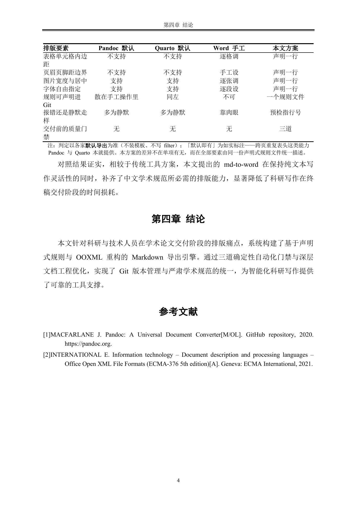

# md-to-word: Compliant Word (.docx) Typesetting Skill for AI Agents & Markdown

[English](README_EN.md) | [简体中文](README.md)

> **Write with Markdown and track with Git; let AI deliver compliant Word (`.docx`) documents automatically.**  
> Effortlessly produce Word files meeting the rigorous formatting standards of **university theses, academic journals, corporate whitepapers, and official reports**.

---

## 💡 Why Markdown + md-to-word?

When writing academic theses, technical reports, and corporate proposals, teams often suffer from Word's inherent collaboration bottlenecks:

* **Word (`.docx`) is an Opaque Binary Black Box**: Git cannot perform line-by-line diffs on binary files. Branch merges frequently corrupt documents, forcing teams to rely on painful file names like `thesis_final_v2_really_final.docx`.
* **Format Tuning Wastes Endless Time**: Authors spend hours manually formatting styles, unlinking headers, adjusting table borders, and pressing spaces to align equations—only to lose all formatting when text content changes.

**The Modern Engineering Workflow of md-to-word**:
1. **Decouple Content from Typography**: Authors write pure Markdown, enjoying the full benefits of Git version control, branching, Pull Request reviews, and CI/CD pipelines.
2. **AI-Agent Native**: LLMs excel at generating and refactoring Markdown; paired with this skill, AI agents can execute end-to-end typesetting and delivery autonomously.
3. **Deterministic Delivery**: Powered by a clean Word 365 base template and declarative specifications, the tool automatically compiles standardized Word documents that satisfy strict review requirements.

---

## ⚡ 30 seconds: what you write vs. what you get

Layout rules live in `requirements.txt` — **one per line, diffable in Git**, no clicking around in Word.

**You write** ([`demo/00_quickstart/hello.md`](demo/00_quickstart/hello.md), excerpt):

```markdown
---
title: "我的第一份规范 Word 文档"
---

# 引言

这是正文。

| 指标 | 方案 A | 方案 B |
|:---|---:|---:|
| 首次排版耗时（秒） | 1.10 | 1.04 |

…(table caption, table note and the crossref prefix are elided here — see the source file)
```

**You run**:

```bash
bash scripts/export.sh hello.md -r requirements.txt -o hello.docx
```

**You get** (about one second):

[](demo/00_quickstart/hello.docx)

Two-character first-line indent, Times New Roman for Latin, a three-line table with caption and note — **none of it clicked together by hand**.

## 📄 Already have a template? (from your school, journal, or employer)

No need to transcribe its formatting by hand. Hand the `.docx` to your assistant and have it reverse-engineer a `requirements.txt` draft:

```bash
python3 scripts/read_reference_docx.py school_template.docx -o thesis_requirements.txt
```

It reads page size, margins, header/footer distances, page-number format and start, per-style CJK and Latin fonts, sizes, bold/italic, alignment, line spacing (**distinguishing multiple / exact / at-least**), space before/after, indentation (**including character units**), paragraph bottom borders, table borders and header rows, and header/footer content and fields. **Anything it cannot read is listed as a to-confirm list** — it does not pretend.


## 🚀 Install It: three steps, all handed to your AI assistant

This skill is tuned for **AI agents** — you never touch a terminal; hand the repository to your assistant and it does the rest.

1. **Let the assistant install it** — paste this line verbatim. Every assistant keeps skills somewhere different, and so does every OS; **let it work that out for itself**:

   > Install this skill for me: https://github.com/ls18166407597-design/md-to-word
   > Clone it into your skills directory, then read SKILL.md and tell me what it can do and how it is triggered.

2. **Verify the install** — ask it to run the smallest sample in the repo. Seeing `✅ Word 文档导出成功` means you are set:

   ```bash
   cd demo/00_quickstart
   bash ../../scripts/export.sh hello.md -r requirements.txt -o hello.docx
   ```

3. **Start using it** — send your Markdown and state the target format:

   > Export this Markdown document to Word (.docx) according to my university's master's thesis formatting guidelines.

   It then handles everything: layout and font requirements, a compliant base template, OOXML cleanup, three quality gates, and the finished `.docx`.

> 💡 **CLI / CI**: you can also call it directly:
> `bash scripts/export.sh input.md [-r requirements.txt] -o output.docx`
>
> Add `--pdf` to also render a PDF through the local Word — **the only way to actually expand the table-of-contents page numbers and chapter-name headers**, and the most direct way to check the finished document.

## 📸 Typesetting Showcase (Self-Documenting Demos)

Besides the minimal sample above, the repository bundles **two complete demos**, both written about md-to-word's engineering principles and benchmarks, demonstrating real-world formatting performance:

### Showcase 1: Academic Thesis & Journal Paper (Full Elements)
> Independent lowercase Roman front-matter page numbers (`i, ii`), a native dynamic TOC (down to level 2), dual-line chapter headers, **a three-line table whose header row repeats when it spans pages**, chapter-scoped equation numbers (`(2.1)`) centred with the number hard right, and GB/T 7714-2015 numeric citations.

📁 Source, formatting rules and one-command reproduction → **[demo/01_chinese_thesis](demo/01_chinese_thesis/README.md)**

| Title & Abstract (Centered Title / No Header) | Dynamic TOC (Dot Leaders / Roman Page Numbers) | Dynamic Chapter Header & Architecture Chart |
| :---: | :---: | :---: |
|  |  |  |

| Centered Math Equations & Convergence Chart | Three-Line Academic Table & GB/T 7714 References |
| :---: | :---: |
|  |  |

---

### Showcase 2: Modern Enterprise Whitepaper & Research Report
> Flat single-section structure, executive summary, sleek single-line header, full-grid data tables, and APA 7th author-date citation style.

📁 Source, formatting rules and one-command reproduction → **[demo/02_modern_report](demo/02_modern_report/README.md)**

| Executive Summary & Section 1 | Efficiency Model & Benchmark Chart | Full-Grid Data Table & APA References |
| :---: | :---: | :---: |
|  |  |  |

---

## 🔍 Comparison: the same result, and what each tool needs to get there

Ground rules: every tool is judged on its **default output** (no custom template, no filter). ⚠️ = possible, but you hand-edit the base template, set it paragraph-by-paragraph and table-by-table, or write XML yourself; ✅ = comes out of the box; ❌ = not available by default. **The last column is what this skill actually asks you to write.**

| Typesetting element | Native Pandoc default | Quarto default Word | Manual Word tuning | 🌟 md-to-word: write this |
|:---|:---:|:---:|:---:|:---|
| **Chinese document basics** | | | | |
| Separate CJK and Latin fonts (SimSun + Times New Roman) | ⚠️ Edit base template | ⚠️ Edit base template | ⚠️ Per paragraph | `正文：宋体/Times New Roman 小四 …` |
| Chinese font sizes + 2-character first-line indent | ❌ | ❌ | ⚠️ Per paragraph | `… 首行缩进2字符` |
| Document proofing language (CJK text not flagged) | ❌ | ❌ | ⚠️ Set manually | `校对语言：zh-CN` |
| **Academic typesetting** | | | | |
| Three-line tables with adjustable rules | ⚠️ Edit base template | ⚠️ Edit base template | ⚠️ Per table | `表格：居中 三线表 线宽上1.5磅 线宽表头下0.75磅` |
| Header row repeats across pages | ✅ On by default | ✅ On by default | ⚠️ Per table, tick a box | `表头：… 跨页重复` |
| Centered display math, equation number hard right | ❌ No numbering (`{#eq-x}` leaks into the text) | ⚠️ Equation centres, number trails it | ⚠️ Manual 3-column tab stops | `$$…$$ {#eq-x}` handles both |
| Dynamic chapter-name header (double rule) | ❌ Edit template + insert field | ❌ Edit template + insert field | ⚠️ Break sections + insert field | `页眉内容：{样式标题:Heading 1}` |
| Roman front matter / Arabic body pagination | ❌ | ❌ | ⚠️ Insert section break by hand | `` |
| Native dynamic table of contents | ⚠️ A real field, but styling needs the base template | ⚠️ A real field, but styling needs the base template | ⚠️ Insert field by hand | `` + 4 style lines |
| Figure/equation cross-references with CJK prefixes | ❌ | ✅ | ❌ | Three `crossref:` lines in YAML |
| Formatted bibliography (GB/T 7714, APA, …) | ✅ citeproc | ✅ citeproc | ❌ | `csl: apa.csl` + `[@key]` in prose |
| **Built for AI and automation** | | | | |
| Layout rules declared in text, reviewable in Git | ❌ Buried in XML and manual steps | ❌ | ❌ | One `requirements.txt` states it all |
| Failure mode: error, or silent drift? | ⚠️ Mostly silent | ⚠️ Mostly silent | ❌ Eyes only | Pre-flight check, reported by line number |
| Quality gates before delivery | ❌ | ❌ | ❌ | Three: pre-flight / number diff / item-by-item audit |

> The ✅ marks under Pandoc and Quarto are **honest** — repeating header rows and citeproc bibliographies, for instance, do come out of the box. The value here isn't that others *can't*; it's that a single `requirements.txt` settles **all of it at once**, with no base-template surgery, no XML, and no per-paragraph clicking.

---

## 📚 FAQ: What is a BibTeX (.bib) File and How to Get It?

For users unfamiliar with academic bibliography workflows:

* **What is `.bib`?**  
  `.bib` (BibTeX) is the global standard plain-text format for structured reference databases. Each entry includes publication type, authors, title, journal, volume, and year.
* **How to Obtain It? (No Manual Coding Required)**:
  1. **One-Click Web Export (Google Scholar, CNKI, Baidu Scholar)**:  
     Search for the paper → click the **"Cite"** button → select **"BibTeX"** → copy the text into `references.bib`.
  2. **Batch Export from Reference Managers (Zotero, EndNote, Mendeley)**:  
     Select papers in your library → right click **"Export Library / Items"** → choose **BibTeX** format.
* **How to Cite in Markdown?**  
  Simply write `[@citekey]` (e.g., `[@vaswani2017]`) in your prose. The compiler will automatically format in-text citations and generate the end-of-document bibliography according to your chosen CSL style (e.g., `chinese-gb7714-2015-numeric.csl` or `apa.csl`).

---

## 🛠️ Environment Prerequisites

Running this skill requires only two lightweight prerequisites:

1. **Python Dependencies** (Python 3.9+):
   ```bash
   pip install -r requirements.txt
   ```
2. **Quarto Engine** (Quarto ≥ 1.4, includes Pandoc):
   ```bash
   # macOS
   brew install quarto

   # Linux / Windows: Download installer from https://quarto.org/docs/get-started/
   ```

---

## 📖 Skill Routing & Documentation

| Path | Purpose & Target Audience |
| :--- | :--- |
| [`demo/00_quickstart/`](demo/00_quickstart/) | **Smallest runnable sample** (1 page): an 18-line manuscript plus a 14-line `requirements.txt` (blank lines excluded). Use it to grasp input vs. output in 30 seconds, and to verify the install. |
| [`SKILL.md`](SKILL.md) | **Must-read for AI Agents**: Agent automation workflows, Markdown syntax contracts, and best practices. |
| [`references/reference.md`](references/reference.md) | **Advanced Customization**: Complete vocabulary for `requirements.txt`, default inference rules, and the 20 built-in CSL styles. |
| [`references/design.md`](references/design.md) | **Developers & Hackers**: In-depth architecture, pure Word 365 base template, 3-column equation alignment, and OpenXML internals. |

---

## 📄 License

Open-sourced under the [MIT License](LICENSE). Contributions and feedback are welcome!
