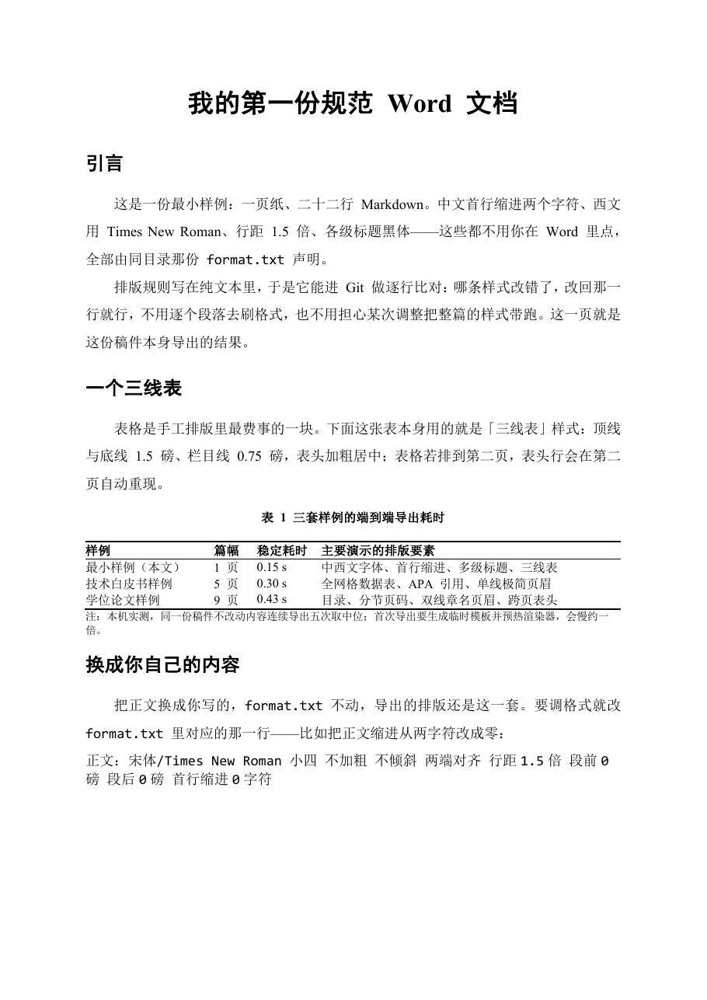
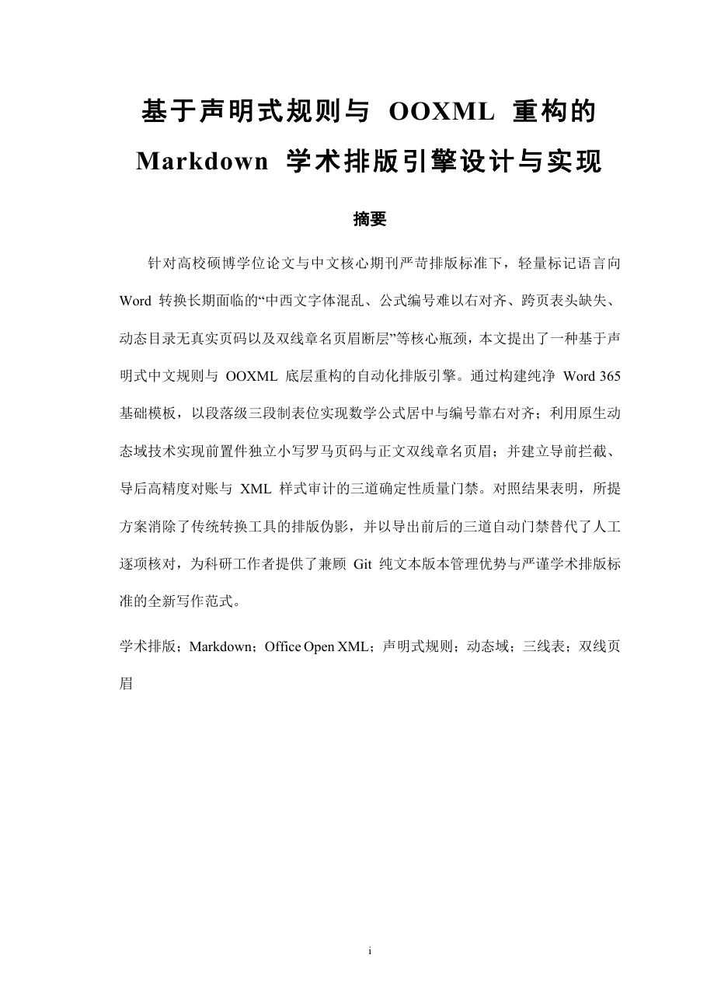
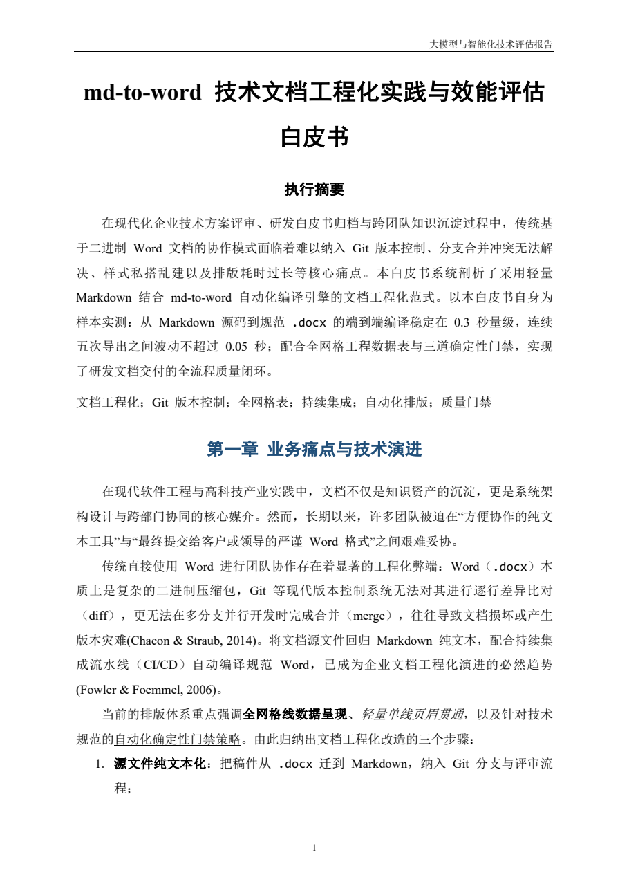
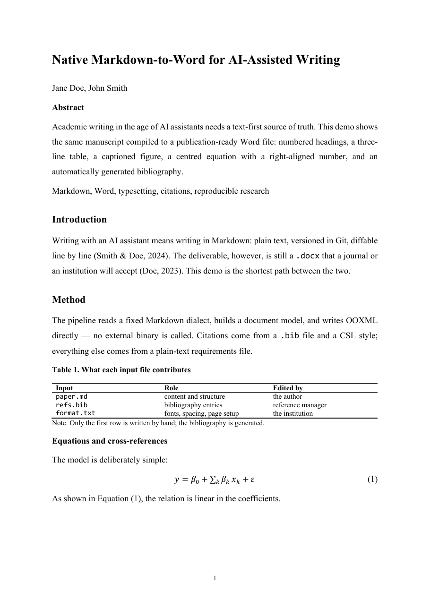

# md-to-word

[](https://github.com/Yuan1z0825/nature-skills/tree/main/skills/nature-paper2word)
[](https://github.com/Imbad0202/academic-research-skills/blob/main/THIRD_PARTY.md#listed-projects)
[](https://github.com/1c7/chinese-independent-developer/blob/master/.github/pages/README-Programmer-Edition.md)
[](https://glama.ai/mcp/servers/ls-open/md-to-word)
[](https://github.com/ls-open/md-to-word/releases)
[](https://github.com/ls-open/md-to-word/blob/main/LICENSE)
[](https://www.python.org/)

**English** | [简体中文](README.md) | [Sample Gallery](https://ls-open.github.io/md-to-word/)

Compile Markdown into compliant Word (`.docx`) documents matching strict formatting specifications. Designed for academic papers, theses, technical reports, and official documents — and built as a deterministic Word compilation engine for AI Agents.

Solves common issues in generic Markdown-to-Word conversions: styling drifts, non-editable equations, tables losing header rows across page breaks, and section-based pagination. Content stays in Markdown; typography rules live in a plain-text `format.txt` tracked in Git.

---

### Sample Gallery

Real documents exported by the compiler (rendered via PDF, not mockups; download `.docx` files on the [Sample Gallery](https://ls-open.github.io/md-to-word/)):

| <a href="demo/00_quickstart/hello.docx"></a> | <a href="demo/01_chinese_thesis/thesis_sample.docx"></a> | <a href="demo/02_modern_report/report_sample.docx"></a> | <a href="demo/03_english_paper/paper.docx"></a> |
|:--:|:--:|:--:|:--:|
| **Minimal Quickstart**<br>One-page shortest path | **Chinese Thesis**<br>TOC field / Roman pages / Header rules | **Modern Technical Report**<br>Grid tables / Callouts / Heading colors | **English Journal Paper**<br>APA author-date / Cross-references |

> 💡 Also includes Traditional Chinese journal, GB/T 9704 official-document body and APA 7 student-paper samples ([`demo/04_zh_tw_paper`](demo/04_zh_tw_paper), [`demo/05_gb9704`](demo/05_gb9704), [`demo/06_apa_student`](demo/06_apa_student)); see [demo/](demo/) for full source files and specs.

---

### Quick Start

Choose your preferred workflow:

#### 1. Command Line (CLI)

Pure Python, no Pandoc, Quarto, or Office required:

```bash
# 1. Install
pip install md-to-word-docx

# 2. Initialize sample project (creates format.txt and a sample manuscript)
md-to-word init

# 3. Compile
md-to-word hello.md -f format.txt -o hello.docx

# (Optional) Run the pre-flight check only; write no file
md-to-word hello.md --validate-only

# (Optional) Export with a built-in preset when no format file is ready
md-to-word hello.md --preset zh-academic -o hello.docx

# (Optional) Machine-readable contract and structured diagnostics for agents
md-to-word --contract --json
md-to-word hello.md -o hello.docx --json
```

#### 2. AI Agents (Claude Code / Terminal Agents)

Install as an Agent Skill so the model typesets according to contract and self-corrects on line-numbered gate errors:

```bash
npx skills add ls-open/md-to-word
```

*(If using [Nature Skills](https://github.com/Yuan1z0825/nature-skills), prompt the agent with requests like "export paper to Word" or "format as submission docx" to trigger automatically.)*

#### 3. Desktop MCP Clients (Claude Desktop / Cursor)

Add to your `mcpServers` configuration (`uvx` runs in an isolated virtual environment automatically):

```json
{
  "mcpServers": {
    "md-to-word": {
      "command": "uvx",
      "args": ["--from", "md-to-word-docx[mcp]", "md-to-word-mcp"]
    }
  }
}
```

---

### Key Capabilities

- **Native Vector Equations**: Renders native Word OMML math objects (vector, double-click editable in Word, not raster images), centered with equation numbers right-aligned, supporting `@eq-` cross-references.
- **Three-Line Tables**: Rule weights declared per style; with `repeat header` (`跨页重复`) in the format file, header rows repeat across page breaks (built-in presets enable it).
- **Independent Section Pagination**: Roman front-matter numerals (`i, ii`) and Arabic body numerals (`1, 2`) with native Word Table of Contents field (F9 to refresh) and dynamic chapter running headers.
- **29 Built-in CSL Styles**: Supports GB/T 7714, Nature, IEEE, APA, Science, and more; bibliography generated automatically from `.bib` or CSL-JSON (Zotero, Mendeley, Crossref exports).
- **Line-Numbered Quality Gates**: Pre-flight manuscript validation, post-flight content-loss check, and OpenXML styling reconciliation with line numbers for fast remediation. `--validate-only` runs the pre-flight check without writing a file.
- **Tolerant Input Encoding**: Manuscripts, format files and `.bib` files may be UTF-8 (with or without BOM), UTF-16 or GB18030; non-UTF-8 input is read and reported with a reminder to save it as UTF-8.
- **Byte-Identical on Same Platform**: Fixed timestamps, file permissions, and packaging sequencing ensure byte-identical outputs on the same platform for reliable Git diffs.

---

### Working with Existing Word Templates

- **Reverse-engineer format declarations**: Extract a starting `format.txt` from a reference `.docx`:
  ```bash
  md-to-word-template template.docx -o format.txt
  ```
- **Inject manuscript into existing template**: Keep institutional covers and front matter untouched:
  ```bash
  md-to-word paper.md -f format.txt --base-template template.docx --keep-until "Author signature" -o paper.docx
  ```
  `--keep-until` names the **last line you want kept** (inclusive); single- and multi-section bases are both cut after that paragraph. To keep a whole page name that page's last line; to keep whole sections use `--cover-sections N`. Compatibility mode, mirror margins, punctuation compression and odd/even headers must match the format, or the export is refused.

---

### Syntax Quick Reference

| Element | Markdown Syntax | Description |
|:--|:--|:--|
| **Paragraph Style** | `%% Abstract This paper presents...` | `%% StyleName` at line start assigns specific Word style |
| **Numbered Equation** | `$$E=mc^2$$ {#eq-mass}` | Standalone line; referenced in body text via `@eq-mass` |
| **Captions** | `%% Table Caption **Table 1** Performance`<br>`%% Image Caption Figure 1 Architecture` | The caption stays on the same page as its figure or table |
| **Citations** | Body `[@smith2024]`, YAML `bibliography: refs.bib` | Formatted according to selected CSL style |
| **Structure Tags** | ``, `` | Table of contents; named sections (declare `Section: body` in the format file first) |

> For the full vocabulary and contract specifications, see the [Manual](src/md_to_word/resources/manual_en.md) or run `md-to-word --contract`.

---

### Known Limitations

- **Byte-identical scope**: Binaries are byte-identical on the same operating system platform; cross-platform builds differ in underlying zlib deflate compression streams.
- **Unsupported layouts**: Markdown and the single-column document model do not support merged cells, diagonal table headers, multi-column mixing, or text-wrapped floating shapes.
- **PDF rendering**: The `--pdf` flag requires Word on macOS to expand Word fields; without Word, the `.docx` is produced and PDF is skipped.
- **Fonts and office suites**: a `.docx` records font names, not the fonts themselves; if the opening machine lacks one, Word substitutes it and pagination can shift. WPS opens the file, but does not expand the TOC field and may show an error in a `STYLEREF` chapter header. Microsoft Word is the acceptance target.

### Ecosystem

- **[Nature Skills](https://github.com/Yuan1z0825/nature-skills)**: Academic research and writing agent toolkit. The skill version is merged into that repository (as `nature-paper2word`) to deliver compliant Word documents in the final stage.
- **[Academic Research Skills](https://github.com/Imbad0202/academic-research-skills)**: a suite of five research skills with a 10-stage pipeline. Listed among its third-party projects, directly compiling Stage 5 (FINALIZE) Markdown and `.bib` outputs into Word.
- **[Chinese Independent Developer](https://github.com/1c7/chinese-independent-developer/blob/master/.github/pages/README-Programmer-Edition.md)**: Featured in the developer showcase.

---

### License

[MIT License](LICENSE). Built-in CSL styles from [citation-style-language/styles](https://github.com/citation-style-language/styles) (CC BY-SA 3.0).
