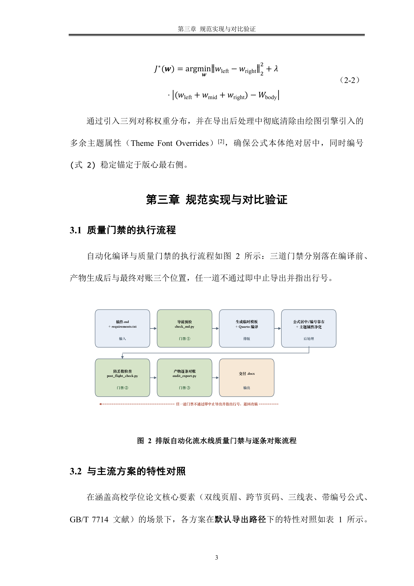

# md-to-word: Automated Markdown to Publication-Ready Word (.docx) Tool & AI Skill

[English](README_EN.md) | [简体中文](README.md)

> **Say goodbye to manual Word style formatting forever!**  
> One command—or automated end-to-end by an AI Agent—converts standard Markdown into publication-ready Word (`.docx`) documents conforming to strict academic theses, journal papers, corporate whitepapers, and official reports.

---

## 📸 Visual Showcase

Whether you are writing a rigorous academic thesis or a high-density corporate whitepaper, `md-to-word` delivers pixel-perfect typography:

### Showcase 1: Academic Thesis & Journal Paper (Full Elements)
> Lowercase Roman front-matter page numbers (`i, ii`), native Word dynamic Table of Contents (TOC), dynamic chapter headers (`STYLEREF`), three-line academic tables with repeating header rows across pages, centered mathematical equations with right-aligned numbering, and GB/T 7714 / IEEE citations.

| Title & Abstract (Centered Title / No Header) | Dynamic TOC (Dot Leaders / Roman Page Numbers) | Dynamic Chapter Header & Centered Figure |
| :---: | :---: | :---: |
|  |  |  |

| Centered Math Equations & Three-Line Table | Repeating Header Row & Bibliography |
| :---: | :---: |
|  |  |

---

### Showcase 2: Modern Enterprise Whitepaper & Research Report
> Flat single-section structure, executive summary, sleek single-line header, compact business grid table, and APA 7th author-date citation style.

| Executive Summary & Section 1 | Efficiency Model & Benchmark Chart | Compact Business Table & APA References |
| :---: | :---: | :---: |
|  |  |  |

---

## 💡 Why md-to-word? Traditional Pandoc vs md-to-word

| Element | Traditional Pandoc / Manual Word Tuning | 🌟 md-to-word Automated Solution |
| :--- | :--- | :--- |
| **Typography & Fonts** | Headers turn blue, Chinese/Latin fonts get mangled, styles inherit messy Word defaults | **Pure Word 365 Base Template**: CJK and Latin fonts are cleanly bound independently; strictly prevents style pollution. |
| **Math Equations** | Equation numbers break onto new lines; users resort to manually typing spaces | **Automatic 3-Column Borderless Table**: Equation is centered on the page; equation number `(1)` or `(1.1)` is strictly anchored to the right margin. |
| **Table Formatting** | Plain black borders by default; no three-line tables; headers disappear across page breaks | **Declarative Academic Tables**: Configurable top/bottom/header border widths; table header **automatically repeats on subsequent pages**. |
| **TOC & Pagination** | Markdown cannot produce real page numbers; front-matter and body share one page sequence | **Native Dynamic Fields & Section Breaks**: Supports `` with dot leaders; independent Roman (`i, ii`) front-matter and Arabic (`1, 2`) body pagination. |
| **Figure Artifacts** | Figures wrapped in single-cell tables inadvertently inherit table borderlines | **Pure Native Centered Figures**: Eliminates table wrapper artifacts; clean captions; prevents awkward page break gaps. |
| **Quality Assurance** | Silent failures when formatting rules don't match; post-processors risk dropping paragraphs | **3 Deterministic Quality Gates**: Pre-flight syntax validation, post-flight high-precision number matching, and OpenXML style auditing. |

---

## 🚀 Getting Started: 3 Levels for Every User

We provide three tiered workflows tailored to your technical background:

### Level 1: Zero Barrier (AI Agent Full Automation ✨ Recommended)
If you use Claude Code, Cursor, Windsurf, Antigravity, or similar AI coding assistants:
1. Clone this repository into your Agent's skills directory;
2. Simply ask your AI in natural language:
   > *"Export my Markdown paper to Word (.docx) following the attached university/journal formatting guidelines."*
3. The AI handles everything: requirements extraction, Markdown sanitization, template compilation, rendering, and quality gate auditing.

---

### Level 2: Lightweight Daily Use (Reports & Documentation)
For documents that do not require complex `.bib` references or multi-section pagination:
1. Write standard Markdown, separating sections with ``;
2. Run one command to export with modern elegant defaults:
   ```bash
   bash scripts/export.sh my_document.md -o output.docx
   ```

---

### Level 3: Professional Academic Publishing (Theses & Journal Papers)
For strict university theses or top-tier journal submissions:
1. **Declare custom rules in a plain text file (`requirements.txt`)**:
   ```text
   纸张：A4
   页边距：上2.54cm 下2.54cm 左2.54cm 右2.54cm
   页码：阿拉伯 起始1
   页眉：宋体/Times New Roman 小五 居中 行距1.0倍 段前0磅 段后0磅 首行缩进0字符 下边框双线
   页眉内容：{样式标题:Heading 1}
   正文：宋体/Times New Roman 小四 不加粗 不倾斜 两端对齐 行距1.5倍 段前0磅 段后0磅 首行缩进2字符
   表格：居中 三线表 线宽上1.5磅 线宽底1.5磅 线宽表头下0.75磅 单元格垂直居中
   表头：宋体/Times New Roman 五号 加粗 不倾斜 居中 行距1.0倍 段前0磅 段后0磅 首行缩进0字符 跨页重复
   ```
2. **Specify CSL in Markdown frontmatter** (20 normalized styles included, e.g., APA, IEEE, Nature, Science, GB/T 7714):
   ```yaml
   ---
   title: "Paper Title"
   bibliography: references.bib
   csl: apa.csl
   ---
   ```
3. **Export and audit**:
   ```bash
   bash scripts/export.sh my_paper.md -r requirements.txt -o my_paper.docx
   ```

---

## 📂 Out-of-the-Box Demos

Two fully verified sample projects are included under `demo/`:

1. **[Academic Thesis & Journal Demo (`demo/01_chinese_thesis/`)](demo/01_chinese_thesis/README.md)**
   * **Features**: Lowercase Roman page numbering (`i, ii`), Word dynamic TOC ``, dynamic chapter headers, centered math with right-aligned numbering, repeating table headers, and GB/T 7714-2015 numeric citations.
   * **Run**:
     ```bash
     cd demo/01_chinese_thesis
     bash ../../scripts/export.sh thesis_sample.md -r requirements.txt -o thesis_sample.docx
     ```

2. **[Modern Enterprise Whitepaper Demo (`demo/02_modern_report/`)](demo/02_modern_report/README.md)**
   * **Features**: Flat single-section structure, executive summary, sleek single-line header, compact business grid table, pure native centered figures, and APA 7th citations.
   * **Run**:
     ```bash
     cd demo/02_modern_report
     bash ../../scripts/export.sh report_sample.md -r requirements.txt -o report_sample.docx
     ```

---

## 🛠️ Prerequisites & Installation

1. **Install Python Dependencies** (Python 3.9+):
   ```bash
   pip install -r requirements.txt
   ```
2. **Install Quarto** (Quarto $\ge 1.4$, bundled with Pandoc):
   ```bash
   # macOS
   brew install quarto

   # Linux / Windows: Download installer from https://quarto.org/docs/get-started/
   ```

---

## 📖 Navigation & Documentation

| Path | Description |
| :--- | :--- |
| [`SKILL.md`](SKILL.md) | **Must-read for AI Agents**: Agent delegation workflow, Markdown layout contracts, and best practices. |
| [`references/reference.md`](references/reference.md) | **Customization Reference**: Complete vocabulary for `requirements.txt`, layout defaults, 20 bundled CSL styles, and visual verification SOP. |
| [`references/design.md`](references/design.md) | **Architecture & Under the Hood**: Pure Word 365 base template design, 3-column equation layout, and OpenXML troubleshooting. |

---

## 📄 License

This project is licensed under the [MIT License](LICENSE). Contributions and feedback are welcome!
