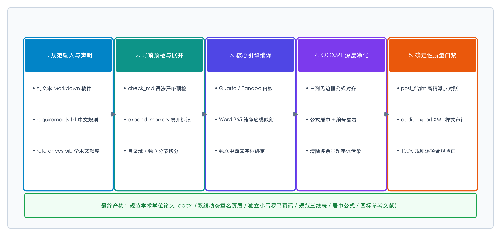
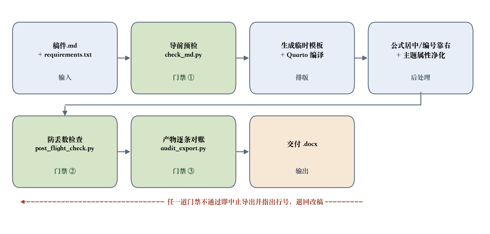

%% 摘要标题 摘要

%% 摘要 针对高校硕博学位论文与中文核心期刊严苛排版标准下，轻量标记语言向 Word 转换长期面临的“中西文字体混乱、公式编号难以右对齐、跨页表头缺失、动态目录无真实页码以及双线章名页眉断层”等核心瓶颈，本文提出了一种基于声明式中文规则与 OOXML 底层重构的自动化排版引擎。通过构建纯净 Word 365 基础模板，结合三列无边框约束机制实现数学公式绝对居中与编号精准靠右对齐；利用原生动态域技术实现前置件独立小写罗马页码与正文双线章名页眉；并建立导前拦截、导后高精度对账与 XML 样式审计的三道确定性质量门禁。对照结果表明，所提方案消除了传统转换工具的排版伪影，并以导出前后的三道自动门禁替代了人工逐项核对，为科研工作者提供了兼顾 Git 纯文本版本管理优势与严谨学术排版标准的全新写作范式。

%% 关键词 学术排版；Markdown；Office Open XML；声明式规则；动态域；三线表；双线页眉



%% 目录标题 目录







# 第一章 绪论

## 1.1 研究背景与问题

近年来，随着开源协作与科研工程化理念的普及，基于纯文本轻量标记语言（如 Markdown）配合 Git 进行版本追踪的写作方式正受到广大技术与科研工作者的青睐。与传统封闭的二进制 Word（`.docx`）文档相比，Markdown 具有内容与表现形式彻底解耦、支持逐行差异对比（Git diff）、天然契合多人分支合并以及对大语言模型极其友好的显著优势。

然而，在学术成果向高校研究生院、科研院所与学术期刊提交的最终交付阶段，作者仍被要求提供格式近乎苛刻的 Word 文档。在经典文档转换领域，以 Pandoc 为代表的通用格式转换器奠定了多文档互转的基石 [@macfarlane2020]，但其在面向中文学术规范时存在严重的排版断层[^1]；现代科研排版系统 Quarto 虽然提升了交叉引用体验，但其 Word 输出依然受制于底层样式映射，无法开箱即用支持双线章名页眉与复杂分节；而在 Word 中通过人工反复调整格式，不仅耗费巨大学术精力，且一旦源文本修改即导致排版完全推倒重来。系统总体技术架构流程如图 1 所示。

{width=13cm}

正文排版严格遵循中文学术论文排版契约，支持包括**加粗文本强调**、*斜体变量标注*、化学分子式 H~2~O 表达、数学高维矩阵 $\mathbf{W} \in \mathbb{R}^{d \times k}$，以及[关键技术特征标识]{.underline}等在内的丰富行内格式。

[^1]: 传统工具在未定制模板时容易导致中西文字体脱节，且无法原生处理带点导线的动态计算目录。

# 第二章 核心排版引擎数学建模与机制

## 2.1 版心几何与行高约束

本节建立学术版面几何网格与行高约束的数学模型。设 A4 纸张物理宽度为 $W_{\text{page}}$，左右页边距分别为 $M_{\text{left}}$ 与 $M_{\text{right}}$，版心有效排版宽度定义为 $W_{\text{body}} = W_{\text{page}} - (M_{\text{left}} + M_{\text{right}})$。在标准 20 磅行距网格约束下，文本行垂直离散化坐标演化方程如 @eq-dynamics 所示：

$$H_{n+1} = \mathcal{G}(H_n, \Delta L_n; \boldsymbol{\psi}) + \boldsymbol{\delta}_n$$ {#eq-dynamics}

其中 $\boldsymbol{\psi}$ 为字号与行距复合度量参数张量，$\boldsymbol{\delta}_n$ 表示版面网格规整扰动因子。为实现数学公式居中且编号绝对靠右对齐的出版级视觉效果，我们将版心划分为固定宽度的无边框三列网格，定义公式与编号对齐约束的目标泛函：

$$J^*(\boldsymbol{w}) = \arg\min_{\boldsymbol{w}} \left\| w_{\text{left}} - w_{\text{right}} \right\|_2^2 + \lambda \cdot \left| (w_{\text{left}} + w_{\text{mid}} + w_{\text{right}}) - W_{\text{body}} \right|$$ {#eq-bellman}

通过引入三列对称权重分布，并在导出后处理中彻底清除由绘图引擎引入的多余主题属性（Theme Font Overrides）[@ecma376]，确保公式本体绝对居中，同时编号 `(式 2)` 稳定锚定于版心最右侧。

# 第三章 规范实现与对比验证

## 3.1 质量门禁的执行流程

自动化编译与质量门禁的执行流程如图 2 所示：三道门禁分别落在编译前、产物生成后与最终对账三个位置，任一道不通过即中止导出并指出行号。

{width=13cm}

## 3.2 与主流方案的特性对照

在涵盖高校学位论文核心要素（双线页眉、跨节页码、三线表、带编号公式、GB/T 7714 文献）的场景下，各方案在**默认导出路径**下的特性对照如表 1 所示。

%% 表题 **表 1** 主流方案在中文学术规范场景下的特性对照

| 排版要素 | Pandoc 默认 | Quarto 默认 | Word 手工 | 本文方案 |
| :--- | :---: | :---: | :---: | :---: |
| 中西文字体分离 | 须改底模 | 须改底模 | 逐段设 | 声明一行 |
| 中文号数与首行缩进 | 不支持 | 不支持 | 逐段设 | 声明一行 |
| 全文校对语言 | 不支持 | 不支持 | 手动设 | 声明一行 |
| 学术三线表 | 须改底模 | 须改底模 | 逐表设 | 声明一行 |
| 全网格数据表 | 须改底模 | 须改底模 | 逐表调 | 声明一行 |
| 跨页重复表头 | 默认即有 | 默认即有 | 逐表勾选 | 可显式声明 |
| 双线章名页眉 | 须改底模插域 | 须改底模插域 | 逐节断开 | 声明一行 |
| 罗马/阿拉伯分节 | 不支持 | 不支持 | 手工插 | 声明一行 |
| Word 原生目录 | 有域，须改底模 | 有域，须改底模 | 手工插域 | 声明一行 |
| 目录点线与缩进 | 须改底模 | 须改底模 | 逐条调 | 声明一行 |
| 公式居中＋编号靠右 | 无编号 | 编号跟随尾部 | 手设制表位 | 自动对齐 |
| 公式按章编号 | 不支持 | 支持 | 手打 | 开个开关 |
| 图表交叉引用 | 不支持 | 图片会掉样式 | 手工编号 | 手写图号 |
| 参考文献排版 | 支持 | 支持 | 不支持 | 声明一行 |
| 引用可点击跳转 | 支持 | 支持 | 手工插书签 | 默认开启 |
| 脚注 | 支持 | 支持 | 支持 | 声明一行 |
| 引用块样式 | 须改底模 | 须改底模 | 逐段设 | 声明一行 |
| 图片题注 | 支持 | 支持 | 手动编号 | 声明一行 |
| 页码格式与起始 | 不支持 | 不支持 | 手工设 | 声明一行 |
| 奇偶页不同页眉 | 须改底模 | 须改底模 | 逐个设 | 声明一行 |
| 首页不同页脚 | 须改底模 | 须改底模 | 手动设 | 声明一行 |
| 表格单元格内边距 | 不支持 | 不支持 | 逐格调 | 声明一行 |
| 页眉页脚距边界 | 不支持 | 不支持 | 手工设 | 声明一行 |
| 图片宽度与居中 | 支持 | 支持 | 逐张调 | 声明一行 |
| 字体自由指定 | 支持 | 支持 | 逐段设 | 声明一行 |
| 规则可声明进 Git | 散在手工操作里 | 同左 | 不可 | 一个规则文件 |
| 报错还是静默走样 | 多为静默 | 多为静默 | 靠肉眼 | 预检指行号 |
| 交付前的质量门禁 | 无 | 无 | 无 | 三道 |

%% 表注 注：判定以各家**默认导出**为准（不装模板、不写 filter）；「默认即有」为如实标注——跨页重复表头这类能力 Pandoc 与 Quarto 本就提供。本方案的差异不在单项有无，而在全部要素由同一份声明式规则文件统一描述。

对照结果证实，相较于传统工具方案，本文提出的 md-to-word 在保持纯文本写作灵活性的同时，补齐了中文学术规范所必需的排版能力，显著降低了科研写作在终稿交付阶段的时间损耗。

# 第四章 结论

本文针对科研与技术人员在学术论文交付阶段的排版痛点，系统构建了基于声明式规则与 OOXML 重构的 Markdown 导出引擎。通过三道确定性自动化门禁与深层文档工程优化，实现了 Git 版本管理与严肃学术规范的统一，为智能化科研写作提供了可靠的工具支撑。

%% 参考文献标题 参考文献

::: {#refs}
:::
