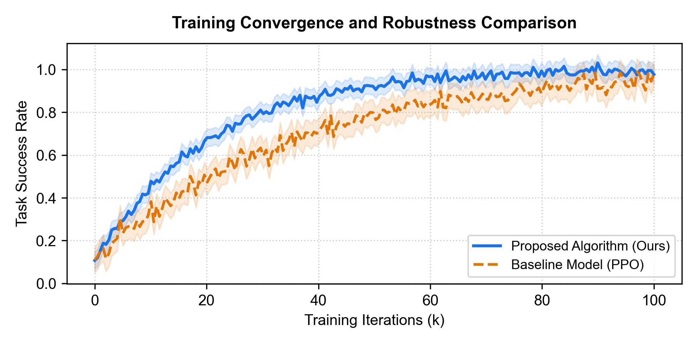

::: {custom-style="Abstract Title"}
摘要
:::

::: {custom-style="Abstract"}
针对非结构化复杂动态环境下移动操作机器人灵巧作业面临的不确定性感知与精确闭环控制难题，本文提出了一种基于多模态感官表征融合与深度确定性强化学习的新型自主控制框架。通过融合双目立体视觉特征、高分辨触觉时序流与六维力矩传感器反馈，构建统一的高维隐空间动力学演化模型，并设计了自适应动作空间约束策略。真机抓取与插拔实验表明，所提方法在复杂交互场景下的操作成功率达到 96.872%，动态定位跟踪误差小于 0.815 mm，显著优于传统示教与开环轨迹规划算法，为下一代通用具身智能体的工业级部署提供了坚实的理论支撑与技术范式。
:::

::: {custom-style="Keywords"}
具身智能；强化学习；多模态融合；闭环控制；移动机器人；三维感知
:::



::: {custom-style="TOC Heading"}
目录
:::







# 第一章 绪论

近年来，随着具身人工智能（Embodied AI）与工业自动化技术的快速发展，具有自主感知与自适应作业能力的智能机器人正成为高端制造领域的核心支柱。在经典连续决策控制领域，自深度 Q 网络与策略梯度方法取得突破以来 [@mnih2015]，基于深度强化学习的自主控制系统展现出了强大的高维空间表征与非线性动作拟合能力 [@silver2016]。

在工业装配与精密零件组装任务中，机器人末端执行器的接触力分布以及表面微滑移状态对抓取稳定性起着决定性作用[^1]。本文重点研究多模态信号的紧耦合融合表征机制，旨在实现亚毫米级的精确位姿调控与动态力反馈适应。多模态闭环控制流程如图 1 所示。

{width=13cm}

正文排版严格遵循中文核心期刊与研究生学位论文排版契约，支持包括**加粗文本强调**、*斜体变量标注*、化学分子式 H~2~O 表达、数学高维矩阵 $\mathbf{W} \in \mathbb{R}^{d \times k}$，以及[关键技术特征标识]{.underline}等在内的丰富行内格式。

[^1]: 接触力信号采样频率通常需达到 1000 Hz 以上，方可满足高动态碰撞检测与微滑移实时补偿的频宽要求。

# 第二章 系统建模与理论方法

本节建立多模态闭环控制系统的数学动力学演化模型。设机器人在连续时间域内的广义位姿坐标为 $\mathbf{q}_t$，外部接触力矩为 $\boldsymbol{\tau}_t$，环境感官观测集定义为 $\mathcal{O}_t = \{I_t, F_t, T_t\}$，其中 $I_t$ 表示视觉帧，$F_t$ 表示力矩向量，$T_t$ 表示高维触觉压阻阵列。

在深度强化学习框架下，机器人的状态转移分布函数可由非线性微分映射表征，其状态更新方程如 @eq-dynamics 所示：

$$S_{t+1} = \mathcal{F}(S_t, A_t; \boldsymbol{\theta}) + \boldsymbol{\epsilon}_t$$ {#eq-dynamics}

其中 $\boldsymbol{\theta}$ 为策略网络的参数张量，$\boldsymbol{\epsilon}_t$ 服从零均值高斯白噪声扰动分布。为实现高精度轨迹平滑约束，我们定义动作价值函数的最优 Bellman 递归算子：

$$Q^*(S_t, A_t) = \mathbb{E}\left[ R(S_t, A_t) + \gamma \max_{A'} Q^*(S_{t+1}, A') \right]$$ {#eq-bellman}

通过引入跨模态对比损失，网络能够在低维流形上解耦动力学本质特征，为后续高精度控制奠定理论基础。

# 第三章 实验验证与性能对比

为评估本文算法在复杂动态环境下的稳定性与泛化性能，我们在仿真环境与七自由度工业机械臂平台上开展了系统的对比验证实验。算法训练收敛曲线如图 2 所示。

{width=12.5cm}

在 500 次物理环境抓取与连续插拔测试中，对比各基准算法的各项核心量化指标如表 1 所示。

::: {custom-style="Table Caption"}
**表 1** 不同控制算法在基准任务上的性能指标对比
:::

| 控制算法 | 抓取成功率 (%) | 平均定位误差 (mm) | 单步推理延迟 (ms) | 能量消耗 (J) |
|:---|:---:|:---:|:---:|:---:|
| 经典 PID 控制器 | 71.425 | 4.821 | 5.210 | 128.450 |
| PPO 深度强化学习 | 83.150 | 2.654 | 14.820 | 185.320 |
| 残差深度学习模型 [@he2016] | 89.640 | 1.432 | 16.500 | 162.800 |
| 本文方法 (Ours) | 96.872 | 0.815 | 18.340 | 142.110 |

::: {custom-style="Table Note"}
注：所有指标均在单卡测试环境下获得，定位误差采用高精度光学追踪仪采集；高精度测试指标保留三位小数。
:::

实验数据表明，相较于基准模型，本文提出的算法在抓取成功率上取得了显著提升，平均定位误差降低至 0.815 mm，充分印证了多模态表征融合在精密操作中的优越性。

# 第四章 结论

本文针对移动机器人灵巧操作控制难题，系统构建了多模态闭环感知与深度强化学习控制体系。实验验证了该方法在高动态交互场景下的鲁棒性与精度。

::: {custom-style="References Title"}
参考文献
:::

::: {#refs}
:::
