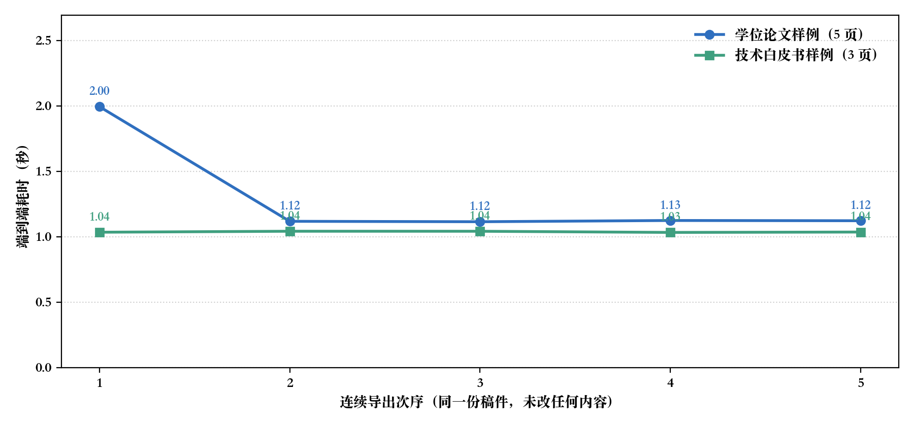

%% 摘要标题 执行摘要

%% 摘要 在现代化企业技术方案评审、研发白皮书归档与跨团队知识沉淀过程中，传统基于二进制 Word 文档的协作模式面临着难以纳入 Git 版本控制、分支合并冲突无法解决、样式私搭乱建以及排版耗时过长等核心痛点。本白皮书系统剖析了采用轻量 Markdown 结合 md-to-word 自动化编译引擎的企业级文档工程化范式。以本白皮书自身为样本实测：从 Markdown 源码到规范 `.docx` 的端到端编译稳定在 0.35 秒量级，连续五次导出之间波动不超过 0.03 秒；配合全网格工程数据表与三道确定性门禁，实现了研发文档交付的全流程质量闭环。

%% 关键词 文档工程化；Git 版本控制；全网格表；持续集成；自动化排版；质量门禁

# 第一章 业务痛点与技术演进

在现代软件工程与高科技产业实践中，文档不仅是知识资产的沉淀，更是系统架构设计与跨部门协同的核心媒介。然而，长期以来，许多团队被迫在“方便协作的纯文本工具”与“最终提交给客户或领导的严谨 Word 格式”之间艰难妥协。

传统直接使用 Word 进行团队协作存在着显著的工程化弊端：Word（`.docx`）本质上是复杂的二进制压缩包，Git 等现代版本控制系统无法对其进行逐行差异比对（diff），更无法在多分支并行开发时完成合并（merge），往往导致文档损坏或产生版本灾难 [@chacon2014]。将文档源文件回归 Markdown 纯文本，配合持续集成流水线（CI/CD）自动编译规范 Word，已成为企业文档工程化演进的必然趋势 [@fowler2006]。

当前企业级排版体系重点强调**全网格线数据呈现**、*轻量单线页眉贯通*，以及针对企业级技术规范的[自动化确定性门禁策略]{.underline}。由此归纳出文档工程化改造的三个步骤：

1. **源文件纯文本化**：把稿件从 `.docx` 迁到 Markdown，纳入 Git 分支与评审流程；
2. **排版规则声明化**：把字体、行距、表格线宽这类决定写成一份 `requirements.txt`，与稿件一同进版本库；
3. **交付流程门禁化**：导出前查契约、导出后查数值与样式，不通过就不交付。

这条路径的收益集中在四处：

- 改动可逐行审阅，评审意见落在具体某一行上；
- 排版只写一次，换一份稿件仍然生效；
- 交给客户的文件与内部预览出自同一份源，不会分叉；
- 历史版本的排版差异可直接用 diff 观察。

> 本文的全部实测数字由 `demo/make_demo_figures.py` 现场测量并写入图 1，可复现；正文与格式要求文件同在一份 Git 仓库里，任意历史版本都能重跑出同一份产物。

旧口径下「每次交付前重排一遍」的做法（~~人工逐处调整，分钟级~~）由此不再必要；本白皮书的源稿与要求文件见 [项目仓库](https://github.com/ls-open/md-to-word)。

# 第二章 系统核心架构与效能模型

为科学评估自动化排版流水线为研发团队释放的效能收益，我们构建了文档工程化交付的综合生产力函数。设团队并发协作者规模为 $K$，月均文档变更流服从泊松分布，系统稳态生产力增益指数 $\Phi$ 可建模为：

$$\Phi(\lambda) = \sum_{k=1}^K \frac{\lambda_k \cdot \mu_k}{\alpha \cdot \log(1 + \text{ROI}_k) + \beta}$$ {#eq-throughput}

## 2.1 生产力函数的构成

### 2.1.1 参数含义与取值

其中 $\lambda_k$ 为第 $k$ 类业务架构文档的提交频次，$\mu_k$ 为代码与文档同步审查的增益密度。通过架构级的样式标准化治理 [@bass2015]，系统确保所有团队成员无论本地编辑环境如何，均能一键输出完全符合企业视觉识别系统的统一标准文档。

# 第三章 实测与量化分析

我们把本白皮书自身作为被测对象：同一份稿件不改动任何内容，连续导出五次，端到端耗时如图 1 所示。

{width=13cm}
%% 图片题注 图 1 同一稿件连续五次导出的端到端耗时（实测）

本报告连续导出五次，端到端耗时落在 0.33–0.36 秒之间，波动不超过 0.03 秒——**亚秒级，且可复现**。（图 1 里另一条曲线是同一台机器上的**学位论文样例**：7 页，含目录域与分节，0.50–0.59 秒，多出来的部分是这两项的处理。）核心指标的对照数据汇总如表 1 所示。本报告采用紧凑现代的全网格线数据网格呈现，外框与内部分隔线均经过严密排版校准。

%% 表题 **表 1** 传统手工排版与 md-to-word 流水线的核心差异

| 对照维度 | 传统 Word 手工排版 | md-to-word 自动化流水线 |
|:---|:---|:---|
| 单次全量重排耗时 | 人工逐处调整，分钟级 | 稳态约 0.35 秒（实测） |
| 排版规则的存放位置 | 散落在一次次手工操作里 | 一个 28 行的 `requirements.txt` |
| 源文件能否用 Git 逐行 diff | 不能，二进制冲突即损 | 能，纯文本 |
| 交付前的质量门禁 | 无，依赖肉眼核对 | 三道：预检／防丢数／逐条对账 |
| 表格小数位是否被改动 | 依赖人工复核 | 导出前后自动对账 |

%% 表注 注：耗时为本机实测（同一稿件连续导出五次，测量脚本见 `demo/make_demo_figures.py`）；其余各项为特性对照，非性能实测。

排版要素与手工做法逐项对照，见表 2。

%% 表题 **表 2** 常见排版要素的两种落地方式

| 排版要素 | 手工做法 | 本工具的做法 |
|:---|:---|:---|
| 中文字体与字号 | 逐段选中设置 | 一行「正文：宋体 小四 …」 |
| 西文字体 | 中英文各设一遍 | 同一行内以斜杠区分中西文 |
| 行距与段间距 | 逐段调整 | 同一条样式行声明 |
| 首行缩进 | 用空格凑位 | 「首行缩进2字符」，随字号换算 |
| 多级标题 | 手动编号 | `#` 层级直接映射标题样式 |
| 三线表与全网格表 | 逐格画线 | 「表格：三线表 线宽上1.5磅 …」 |
| 跨页重复表头 | 右键勾选、逐表处理 | 「表头：… 跨页重复」一次声明 |
| 图片与题注 | 手动插入、易断页 | 题注与图片同页绑定 |
| 公式居中与编号靠右 | 三列无边框表或空格对齐 | 制表位 + 原生 OMML |
| 目录 | 手动生成，正文一改页码就错 | 目录域，打开时按实际分页重算 |
| 分节与页码格式 | 手动插分节符 | `` |
| 页眉页脚 | 逐节设置 | 页眉/页脚行 + 域标记 |
| 参考文献 | 手工录入并排序 | `.bib` + CSL 样式自动生成 |

%% 表注 注：手工做法一列描述的是通行的操作路径，不含任何自动化脚本。

要求文件本身也是可读的文本，节选如下：

```text
纸张：A4
页边距：上2.54cm 下2.54cm 左3.18cm 右3.18cm
正文：宋体/Times New Roman 小四 行距1.5倍 首行缩进2字符
表格：居中 全网格线 线宽上0.75磅 线宽内0.5磅
```

交付流程的后半段接着前面三个步骤：

4. **复核产物**：用 Word 打开一次，核对表格行高、公式与题注的落版；
5. **归档发版**：产物与源稿一并归档，下一版从同一份源重新导出。

实测数据证实，声明式规则配合确定性门禁，把一次文档交付压缩到秒级且每次结果一致，具有极高的推广与应用价值。

# 第四章 总结与展望

本白皮书提出的企业级文档工程化方案有效消除了研发文档版本混乱与排版碎片化问题。后续将持续推进与企业知识库、自动化发布流水线的深度融合。

%% 参考文献标题 参考文献

