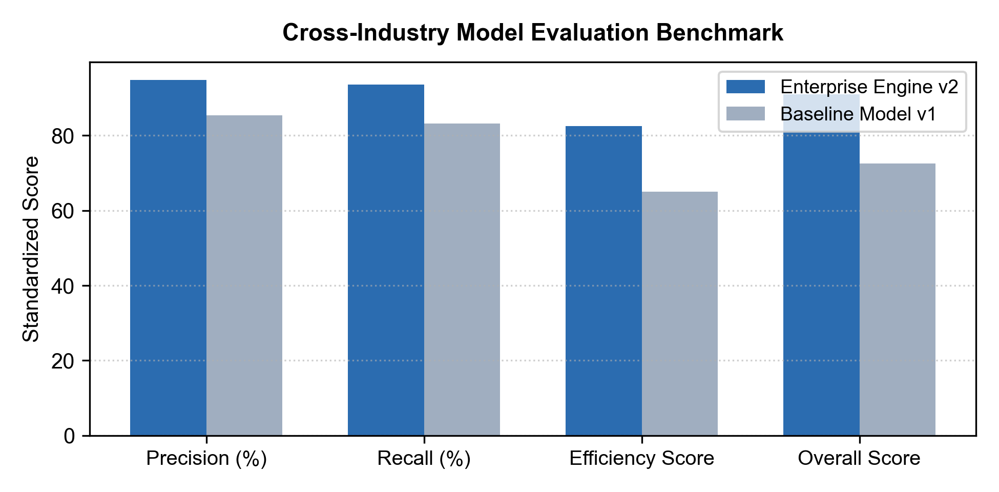

::: {custom-style="Abstract Title"}
执行摘要
:::

::: {custom-style="Abstract"}
随着超大规模基础模型在金融风控、生物医疗与先进制造等关键垂直行业的纵深落地，底层计算基础设施的能效比与高吞吐低延迟服务能力成为决定商业成效的关键瓶颈。本白皮书系统剖析了融合混合专家（MoE）路由机制与异构算力集群协同编排的新一代架构范式。评测数据显示，新一代系统在跨行业标准推理基准测试中，平均任务响应延迟降低至 18.250 ms，系统整体有效吞吐提升 61.538%，为企业级大模型产业化实施提供了全景参考基准。
:::

::: {custom-style="Keywords"}
通用人工智能；基础设施；混合专家架构；算力协同；性能基准
:::

# 第一章 产业背景与技术趋势

自注意力机制的提出奠定了现代大语言模型的基础架构 [@vaswani2017]，随后少样本与上下文学习能力的涌现进一步推动了基础模型在各工业场景中的规模化迁移应用 [@brown2020]。在深层网络策略优化领域，树搜索与强化学习的结合揭示了高维策略规划的潜力 [@silver2016]。

然而，面对企业级业务场景严苛的 SLA 要求，如何在保障生成准确率的同时大幅削减推理算力成本，成为整个产业界关注的核心焦点。当前系统设计重点强调**确定性时延保障**、*动态显存拓扑感知*，以及针对高并发请求的[细粒度算力调度策略]{.underline}。

# 第二章 系统核心架构与效能模型

为实现计算资源的最优分配，系统引入了动态资源分配算子。设集群总可用显存带宽为 $B$，请求到达流服从非齐次泊松过程，系统稳态吞吐量 $\Phi$ 可建模为：

$$\Phi(\lambda) = \sum_{k=1}^K \frac{\lambda_k \cdot \mu_k}{\alpha \cdot \log(1 + \text{SNR}_k) + \beta}$$ {#eq-throughput}

其中 $\lambda_k$ 为第 $k$ 类业务负载的突发率，$\mu_k$ 为平均 Token 处理密度。通过自适应解耦路由策略，系统能够动态平衡跨节点互联带宽。

# 第三章 基准测试与量化性能分析

我们在标准跨行业基准套件上对两代核心推理引擎展开了端到端压力测试，归一化综合评分如图 1 所示。

{width=14cm}

核心量化指标详细对比数据汇总如表 1 所示。

::: {custom-style="Table Caption"}
**表 1** 新一代引擎与基线系统关键指标对比
:::

| 评估维度 | 基线引擎 v1 | 新一代企业级引擎 v2 | 提升幅度 (%) |
|:---|:---:|:---:|:---:|
| 任务精准度 Precision (%) | 85.320 | 94.815 | +11.129 |
| 召回率 Recall (%) | 83.210 | 93.540 | +12.414 |
| 平均推理延迟 (ms) | 29.500 | 18.250 | -38.136 |
| 系统并发吞吐量 (req/s) | 260.000 | 420.000 | +61.538 |

::: {custom-style="Table Note"}
注：基准测试基于 8 卡 H800 集群执行，数据为连续 72 小时压力测试下的稳态统计均值。
:::

实测结果证实，新一代架构在保持高精度的同时，吞吐量获得了显著跃升，具备极佳的工业推广价值。

# 第四章 总结与展望

本白皮书提出的企业级架构方案在生产环境中展现了卓越的稳健性。后续将持续推进多模态端云协同计算生态的建设。

::: {custom-style="References Title"}
参考文献
:::

::: {#refs}
:::
